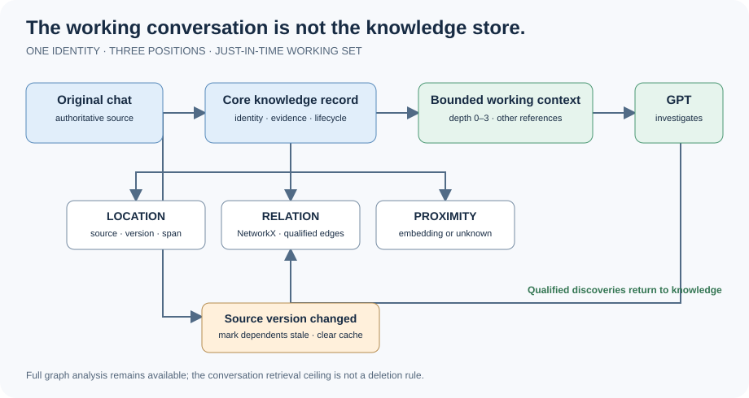
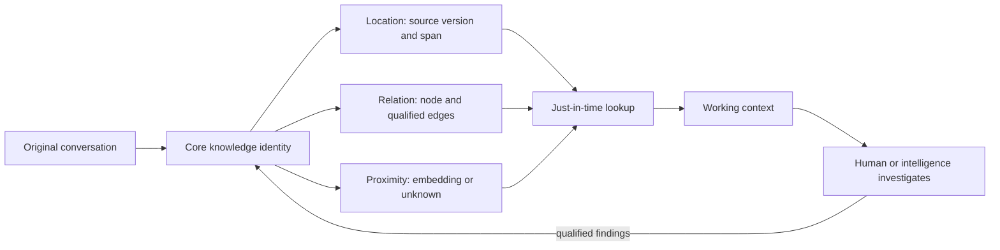
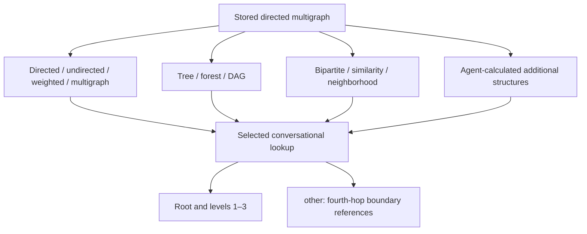
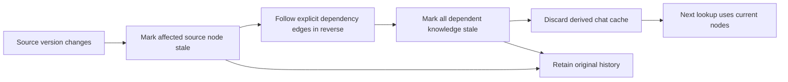
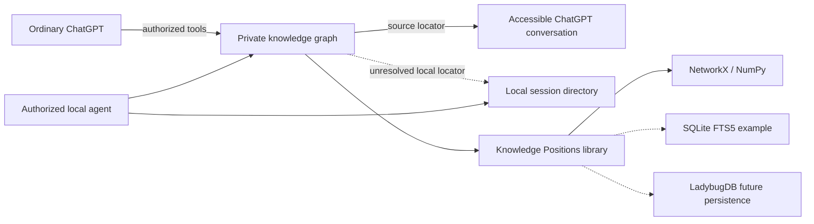

# Architecture

## One conversation. One identity. Three positions.

Knowledge Positions is a lightweight library for **working conversational knowledge**. We do not need to index the entire universe to stop repeatedly learning what we already learned in a chat. Original conversations remain authoritative; referenced code, files and documents stay at their original sources.



### View 1 — Information and representation

```text
ORIGINAL CHAT                  RETRIEVABLE KNOWLEDGE
(authoritative, preserved)     (one identity, three slots)
         |                              |
         +---- source/version/span ---- LOCATION
                                        RELATION  --> NetworkX
                                        PROXIMITY --> vector or null
                                              |
                                  current question / query
                                              |
                              smallest useful working context
                                              |
                                  intelligence investigates
                                              |
                           qualified discoveries return to graph
```



### View 2 — Logical graph and retrieval



All ten named graph views and ten algorithms are native conveniences, not a closed graph language. An intelligence can calculate additional structures with NetworkX or `derive_graph`. The full graph retains original directions, parallel relationships, provenance and costs. The chat retrieval ceiling is strict: root at level 0, expand at most three hops, place boundary references into `other`. Do not load or traverse deeper nodes. The bucket is a retrieval result, not a fabricated entity or a destructive merge. Full graph analysis and invalidation are not depth-limited.

### View 3 — Evolution and invalidation



We did not invent the cascading-staleness mechanism: we learned it from [Garyu-tt/noosphere-lite-mcp](https://github.com/Garyu-tt/noosphere-lite-mcp). Similarity and containment do not cascade by default. A stale record is a review requirement, not proof of falsehood. Writes clear the bounded derived chat cache; direct mutations of the public NetworkX graph require explicit `invalidate_cache()`. No provider prompt cache is modified.

### View 4 — Deployment and source access



Solid connections are the current logical workflow; dashed connections denote optional access or storage alternatives. Web agents maintain their own knowledge repositories; authorized local agents may resolve locally accessible sessions across providers. No cross-provider synchronization, raw-transcript repository, or secrets are required. See [Environment](ENVIRONMENT.md).

### Structural position within an item

**Two complementary location layers:** (1) the source address/realm/version/span, and (2) the structural position *inside that source*—node path, parent path, hierarchy depth and sibling order. Reuse the same coordinate-traversal technique already present in Python AST ingestion, **not an AST requirement for all documents**. `KnowledgePositions.record_item_position` records adapter/reader-supplied structural metadata independently of the node ID, original span hash and vector. `ingest_python` now fills it deterministically on source read; other parsers or watchdog scripts can call the same method.

The generic library accepts native structural paths, stable anchors and exact versioned spans as **alternatives**, without insisting on AST or a page/paragraph hierarchy. Select the strongest available **verified** coordinate method in the shared [canonical order](LOCATION_ACCESS.md#shared-location-method-selection-source-agnostic), retain complementary coordinates, and do not mistake an LLM's descriptive clue for verified evidence. Novel source-specific locators are documented as provisional method conventions in the saved graph for reuse by other authorized readers. Deterministic source parsing can later refine it. Neither the model nor a prompt owns ongoing structural maintenance: the **library** performs idempotent metadata updates when invoked by the host, reader or watcher. This does not claim an automatic reader hook has been installed.

Structural context can be composed with original text as **optional richer embedding input**, using `positioned_embedding_input`. This does not silently recompute old vectors: different input policies must be explicitly distinguished and evaluated. The three-hop retrieval and three-level LLM-enrichment limits remain separate from deterministic indexing/maintenance.

### Portable location and physical ownership

The source position records the *actual* authority, source ID, version and verified coordinates; a separate **access signal** describes its realm and possible route (public/authenticated web, provider-private chat, local file, SSH host, cloud workspace or repository). Discover, read and write permission must be checked for the **current environment and principal**, rather than inferred from a stored locator. Unknown sources remain leads. See [portable location and OKF metadata](LOCATION_ACCESS.md).

Shared knowledge may contain authorized pointers and qualified cross-domain relationships while original evidence and writes remain within their owner's boundary. Separate private stores/databases where required; an `owner` label inside an unrestricted shared database is not an access boundary. An **optional** LadybugDB adapter can persist the Python/NetworkX graph incrementally; it is not the currently implemented JSON backend.

## First pass and enrichment

Core is the twelve [named-reference relationships](CORE_VOCABULARY.md), source-backed identity and three positional slots. Unknown vectors are null, with separate status. Unresolved original-chat IDs are leads, not exact original spans. Capture known prerequisites, evidence and meaningful costs; do not invent edges.

Original evidence, a retrievable representation, an intelligence's understanding, and its live working context are distinct. Preserve authoritative sources, reuse unchanged identities and enrich useful discoveries over time. The sixth-retrieval promotion policy, independent hash gates and broader storage/adapter work remain research directions, not implemented requirements.

### Architectural rule: ingest structure broadly; enrich only as work touches knowledge

**Structural ingestion and semantic enrichment are different operations.** A parser can quickly index an entire codebase's AST, file identities, spans and syntax relationships without running an LLM across it. That structural first pass is not an instruction to summarize, interpret or enrich every file. In the standard path, enrichment happens **when a human or LLM is already working with the source content**: reuse the material already read, add only useful and qualified knowledge/relationships, and persist that delta. An opened repository or a multi-gigabyte source does **not** initiate a whole-corpus LLM enrichment job.

**Maximum three levels of purposeful enrichment** around the currently used source/knowledge; don't recursively expand and ask the model to interpret the rest. Subsequent levels arise only when actual work needs them. Stop when the task's evidence is sufficient, the source is unchanged, or no qualified new relationship exists. This enrichment budget is distinct from (and compatible with) the existing three-hop conversational **retrieval** ceiling; full graph analysis and dependency invalidation are not limited. An explicitly requested offline bulk-enrichment experiment is a separate, opt-in workflow, never the default.

The application/host observes actual source reads or touches and invokes capture at that execution boundary; optional LLM prompts are not a reliable trigger. Compare per-item source and annotation hashes before any expensive work; retain unchanged AST, vectors, identities and relationships. Persist only qualified changes, with authorization and separate owner stores. The [reference application pattern](LOCATION_ACCESS.md#recommended-application-pattern) shows the boundary without changing the library's generic API.

## Design lineage and scope

The [original evolution specification](Knowledge-Asset-Evolution-Spec-v1.6.3.md) and [relationship vocabulary](Knowledge_Graph_Relationships_and_Enrichment.md) remain intact. This chat-only application does not require that broader collector. Optional Python AST ingestion remains a generic library capability; natural-language/document adapters and direct scans of never-indexed sources are planned, not current chat ingestion. SQLite FTS5 can index already-scanned text without copying it into a contentless table; it cannot search a never-scanned document on its own. [SQLite FTS5](https://www.sqlite.org/fts5.html) · [LadybugDB](https://docs.ladybugdb.com/) · [Attribution](ATTRIBUTION.md).

See [Environment](ENVIRONMENT.md) for actual components, [Runbook](RUNBOOK.md) for usage, and [Backlog](BACKLOG.md) / [Roadmap](ROADMAP.md) for remaining work.

## Library versus application instructions

The library defines the data model and operations. It does not prescribe a human's project, provider, storage directory, chat-selection policy or Git workflow. Callers choose those policies; the library implements the source/graph/vector mechanics. A live private-graph deployment is one application of this capability, not a requirement for a new user. See [Quick Start](README.md#quick-start--capture-working-conversations) for standalone use and [the paper's theoretical starting procedure](research/paper.md#14-getting-started-from-an-empty-graph-to-working-knowledge-ekc27).
