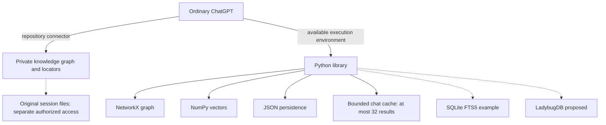

# Environment

## Actual implementation

The current implementation is a standalone Python library, version 0.1.0. [Source code](knowledge_positions.py) is authoritative for actual behavior; [pyproject.toml](pyproject.toml) defines installation dependencies.

| Component | What is actually implemented |
|---|---|
| Python 3.10+ | Library runtime |
| NetworkX | In-memory MultiDiGraph; ten named graph views, native algorithms, custom named derivation, caller-defined relationships |
| Python AST | Optional Python ingestion, source spans, syntax containment and ordered intra-item paths via existing `ast.iter_fields` |
| Sentence Transformers / NumPy | Configurable embeddings, default all-MiniLM-L6-v2; cosine similarity over compatible stored vectors; deferred unknown vector slots |
| JSON | Save/load graph nodes, vectors and edges |
| SHA-256 | Source-version and span hashes; GPS source verification |
| SQLite FTS5 | Contentless lexical index in the GPS example, not the core library |
| GPS example | Separate lexical-hash encoder, graph construction, search, neighbor inspection and source resolution |
| Jupyter / Marimo | Optional human-facing experiment notebooks |

## Runtime boundaries

Original sources remain external to the index.## Runtime boundaries

**Implemented versus proposed:** the Python library currently stores source/version/span fields, NetworkX relationships and JSON graphs; it does **not** enforce access realms, write to LadybugDB or automatically trigger enrichment when a file is read. [Precise location and access signals](LOCATION_ACCESS.md), the implemented **three-touch mutation guard**, and the default on-touch enrichment policy are distinct from the still-uninstalled host hook. LadybugDB remains a proposed persistence backend, not an implemented Knowledge Positions adapter.

Original sources remain external to the index. No mandatory Tree-sitter, graph database, MCP server, LLM server or custom graph-search framework. The graph resides in memory; vector search is linear. The actual model requires local cache or model access. The GPS lexical encoder is not semantic.

Ordered intra-item source-position metadata, optional hash-verified position-aware embedding input, and a persisted **provisional** locator-method catalog are implemented. `ingest_python(..., defer_embedding=True)` can index structure without invoking an embedding model; this does not install a watcher or prove more accurate positional vectors. Explicit dependency-based cascading staleness, deprecation and historical retrieval are implemented. Callers supply changed source versions and explicit revalidation evidence. Automatic monitoring, enrichment, independent ownership hash gates, hybrid ranking and production-scale persistence are not implemented. See [coverage](COVERAGE.md) for evidence and validation gaps. Installation and operation instructions belong in the [Runbook](RUNBOOK.md).

The GPS example indexes text it has already scanned using FTS5 contentless mode; it does not search never-indexed files directly. General document extraction, spaCy natural-language parsing, on-demand scanning, and structured-source adapters are planned, not installed core components. See [Architecture](ARCHITECTURE.md) and [Backlog](BACKLOG.md).

[core_operations.py](core_operations.py) provides a read-only executable example of the core graph algorithms and vector calculations using the existing NetworkX graph and NumPy vectors. It does not introduce a new graph engine, dependency or store. Semantic-model evaluation remains separate from lexical-vector demonstrations.

Native `graph_view`, `derive_graph` and `core_algorithms` are implemented in the library. Public regression tests cover lifecycle and graph-view behavior. Similarity evaluation remains separate from a semantic-model benchmark.

## Runtime / network view — what actually runs

```text
Web ChatGPT session                 Local or cloud execution boundary
+-------------------+   tools      +-------------------------------+
| current question  | -----------> | Knowledge Positions (Python)  |
| retrieved evidence| <----------- | NetworkX + NumPy              |
+-------------------+              | JSON graph / source registry  |
          |                         +-------------------------------+
          | authorized GitHub access           |
          +--------------------------> private knowledge repository

Original chat/session files: separate; resolve only with authorized access.
SQLite FTS5: optional example index. LadybugDB: future persistence option.
```



The chat-only application uses `chat_context(root, relations=..., direction=..., profile=...)`: default Personalized PageRank / random-walk-with-restart attenuation with conservative/balanced/aggressive profiles, plus immediate boundary references in `other`; callers may explicitly request an ego radius. API writes clear the in-memory derived cache; source-version changes cascade staleness through explicit dependencies independently of retrieval breadth. `enrich_node` enforces the hard three-touch semantic mutation cap while allowing outward relationship growth. Direct graph edits must call `invalidate_cache()`. The graph views and algorithms remain available independently of bounded retrieval. No separate service, database server, provider-cache integration or automatic background capture is running. [SQLite](https://www.sqlite.org/) · [LadybugDB](https://docs.ladybugdb.com/).

## Agent capture entry point

[capture.py](capture.py) is the runnable provider-independent capture workflow using the actual library, source registry and GPT-compatible lexical encoder. It initializes, records, links, verifies, searches, reads and retrieves bounded context. It does not acquire chat history by itself. See [README quick start](README.md#quick-start--capture-working-conversations).
