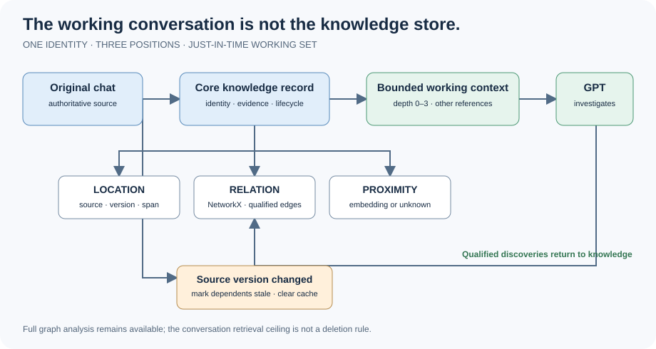

# Knowledge Positions SDK

**One knowledge identity. Many ways to find, traverse, verify and reuse it—without losing the source or starting over.**

Knowledge Positions is an experimental, source-backed knowledge library and a language-neutral SDK contract (UKC/1 candidate). It is for software that needs to preserve and retrieve knowledge from code, documents, conversations, structured data, and other sources **without repeatedly interpreting what the source already says**.

It is **not** an agent, LLM, database, ingestion service, or required application framework. An application calls the library or plugs existing implementations into the same contract. The application chooses its source readers, storage, search methods, and access policy.



## Where this fits in Just-in-Time Knowledge

**Just-in-Time Knowledge (JITK) is the larger research and engineering effort** to make accumulated knowledge available, reusable and able to evolve through work. Direct lookup, AST/tree navigation, graph algorithms, lexical search, vector similarity and database queries already provide different ways to reach knowledge. **Knowledge Positions is the optional, cross-method representation that lets these methods operate on the *same source-backed identity*, with its known values available for the next method to use.** It is not one more search engine alongside those methods. A search result can become a graph traversal, a structural read, a ranking or a source verification without creating a new knowledge object or prescribed conversion chain. Each usable method requires its corresponding recorded values and a compatible mapping to that identity; unavailable values remain unknown.

The Knowledge Positions SDK documents how to implement this shared-identity method. The [JITK skill](skills/knowledge-positions/SKILL.md) helps an agent use available knowledge capabilities with or without Knowledge Positions, and without reading the SDK as a prerequisite. Files, codebase tools, OmniGraph, search engines and other systems provide access and execution, not competing knowledge identities by default.

For the research framing and how the paper, method, SDK, skill and storage systems relate, see [§1.2 of the canonical JITK paper](research/paper.md#12-the-larger-endeavor-jitk-knowledge-positions-and-practical-use).

## What problem does this solve?

Imagine an application has already encountered a source file, a paragraph, and a link to another document. A later question may start with a filename, a nearby concept, or the related document. Without a shared identity and preserved source positions, each route can create a different representation and require a new investigation.

**Knowledge Positions keeps known observations together under one source-backed identity.** Location resolves exact evidence; Relation makes observed or qualified connections traversable; Proximity offers lexical, fuzzy and compatible-vector candidates. These are three addressable aspects of the *same record*, not three methods that must be executed in order. For example, a lexical hit can resolve a record ID, a graph traversal can follow its real edges, a structural reader can inspect its native node, and a query can filter its recorded attributes—all without changing the identity. A method that lacks the required recorded values cannot fabricate them; new verified findings enrich that same identity with provenance.

**Why use this kit rather than build it from scratch?** The existing Python library already supplies source-position records, deterministic repeat admission within its legacy identity scheme, directed relationships, graph traversal/algorithms, deferred vectors, persistence, and lifecycle operations. The SDK contract specifies how independent implementations should preserve identity, native values, provenance, failure states, and portability. Its examples and conformance requirements make results inspectable instead of merely plausible.

The contract is language-neutral. **The currently installable implementation here is Python; Rust scanner/ingester source exists in a separate workspace; a complete TypeScript binding is not yet supplied.** Do not mistake the existing Python library's historical record IDs for certified UKC/1 canonical IDs.

## Install and run your first example

Requirements: Python 3.10+, Git, and access to the public repository. The example uses only the existing library, with embeddings deferred. It does **not** require an LLM, API key, GPU, database server, or source files from anyone else's machine.

```sh
git clone https://github.com/l00p3rl00p/barely-passable-ai-stuff.git
cd barely-passable-ai-stuff/knowledge-positions
python -m pip install .
python examples/sdk_first_use.py
```

The install uses the existing [`pyproject.toml`](pyproject.toml). Its declared Python dependencies are `networkx`, `numpy`, and `sentence-transformers`; **this particular example does not load or download an embedding model**.

### What the example does

1. Records two passages with exact UTF-8 byte ranges and the original source SHA-256.
2. Re-admits the first passage and checks that its identity stays the same.
3. Records an observed `next_passage` relationship and reads it through the graph.
4. Verifies the next passage against the original bytes.
5. Saves and reloads the existing graph without changing the identities.

**Expected output (JSON):**

```json
{
  "same_identity": true,
  "nodes": 2,
  "edges": 1,
  "first_text": "Alpha is a paragraph.",
  "next_text": "Beta follows Alpha.",
  "vector_status": "unknown",
  "source_verified": true,
  "reloaded": true
}
```

The [complete example](examples/sdk_first_use.py) asserts this output; a failed assertion produces a nonzero exit status. It demonstrates the **existing Python API** only; it does not imply that all UKC/1 conformance tests pass.

Run the standalone smoke check after installation:

```sh
bash tools/check-sdk.sh
```

It compiles the existing library and first-use example, then runs the example's assertions. It is a **smoke test**, not UKC/1 certification.

## Cookbook: choose the result you want

| Goal | Existing recipe / example | Compare with |
|---|---|---|
| Build, search, traverse, and read exact evidence | [GPS end-to-end walkthrough](examples/gps/README.md) | [Recorded GPS evidence](research/EXPERIMENT.md) |
| Preserve Python source structure and imports | [Code example](examples/source-mappings.md#a-code--actual-parser-shape-not-invented-software-semantics) | [Native parser observations](readers/native-parser-fidelity.md) |
| Read links from HTML, Markdown, or a book | [Seven source-mapping examples](examples/source-mappings.md) | [Recorded characterization](conformance/characterization.md) |
| Preserve CSV values without inventing numeric types | [CSV shoe-size example](examples/source-mappings.md) | [Native-to-common field mapping](readers/native-to-common.md) |
| Make opaque files discoverable without interpreting their contents | [Binary example](examples/source-mappings.md) | [Algorithm crosswalk](methods/algorithm-crosswalk.md) |
| Check whether another implementation is equivalent | [UKC/1 conformance requirements](conformance/requirements.md) | [Contract and certification conditions](contracts/public-operations.md) |

The [full example collection](examples/README.md) groups the original inputs, preserved values, and observed outputs. Some historical characterization runners are not checked into `main`; those pages state this limitation instead of claiming they are runnable.

## Use the API you actually have

The current Python distribution exposes `KnowledgePositions` from [`knowledge_positions.py`](knowledge_positions.py). These are **real existing entry points**, not speculative SDK functions:

| Task | Existing Python API |
|---|---|
| Admit a source-backed passage | `add(source, text, version=..., position=..., defer_embedding=True)` |
| Read recorded items | `graph.nodes[id]` |
| Record and navigate observed relationships | `link(...)`, `neighbors(id)`, `graph_view(...)` |
| Select graph algorithms | `core_algorithms(...)`, `derive_graph(...)` |
| Find candidates | `search(text)`; vector computation when an encoder is supplied |
| Refine within-source position | `record_item_position(...)` |
| Preserve and reload a graph | `save(path)`, `KnowledgePositions.load(path)` |
| Manage changed sources and knowledge history | `mark_source_changed(...)`, `invalidate(...)`, `deprecate(...)` |

Use [the complete existing Python library guide](docs/python-library-guide.md) for capture workflows and graph behavior. The current library raises standard Python exceptions such as `ValueError` and `KeyError` for invalid inputs; it does **not** yet implement every typed failure defined by the candidate [UKC/1 contract](contracts/public-operations.md).

### Language and integration boundaries

- [Python](languages/python/README.md) — the installable existing API and its compatibility limitations.
- [Rust](languages/rust/README.md) — existing native scanner and ingester source; not a falsely advertised Rust UKC library.
- [TypeScript](languages/typescript/README.md) — contract entry point, not an installable binding yet.
- [Adapters](adapters/README.md) — existing OmniGraph integration and optional agent host profiles.

The [capability map](docs/component-and-capability-map.md) separates implemented functions, adapters, specification requirements, and unverified gaps.

## How to know your result is correct

**A valid result has an identity, a source/version, the original value and location when known, honest observed/qualified relationships, and explicit unavailable values.** Similarity alone is a lead, never proof of a relationship. Exact source resolution must reject changed bytes or inaccessible sources rather than silently substitute another source.

The [UKC/1 contract](unified-knowledge-context.md) defines the common record, canonical IDs, API semantics, supported method families, and import/export requirements. [Conformance](conformance/requirements.md) describes the required behavior for a conforming implementation, including source-fidelity, cross-language comparison, and failure states. A contract specification or successful Python example is **not a claim of full UKC/1 certification**.

## SDK reference, maintenance, and origins

- [UKC/1 specification and API reference](unified-knowledge-context.md)
- [First Law: one identity, one common knowledge record](contracts/first-law.md)
- [Canonical identity](core/identity.md), [source adapters](readers/source-adapters.md), [data interchange](contracts/common-record.md)
- [Contributing](CONTRIBUTING.md), [coverage and limitations](COVERAGE.md), [existing research](research/paper.md)
- [Original Python project guide](docs/python-library-guide.md)

**Status:** Experimental Python library (`0.1.0` in `pyproject.toml`) and UKC/1 candidate specification. The original sources and accepted discoveries are authoritative; graph and search indexes are reconstructable projections. Other implementations may use any suitable language, parser, or database as long as they meet and demonstrate the shared contract.
