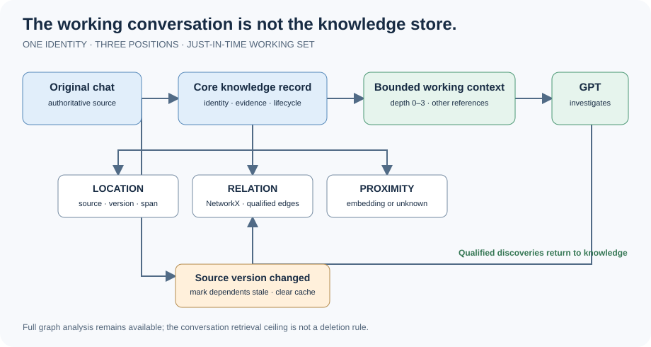

# Knowledge Positions

**Experimental / pre-standard.** A small Python library for just-in-time knowledge navigation: one identity, three positions (source, vector, graph). Keep original evidence accessible and let the intelligence construct and navigate its own graph using NetworkX.

## Quick start — capture working conversations

Knowledge Positions is a Python library, not a required agent workflow, provider account, repository layout or service. You supply the source access, choose what knowledge matters, and choose where it lives. The library provides source, graph and vector positions and the operations that maintain them.

### 1. Install and create a knowledge store

From an existing checkout, or clone the public library:

```bash
git clone https://github.com/l00p3rl00p/barely-passable-ai-stuff.git
cd barely-passable-ai-stuff/knowledge-positions
python -m pip install .
# Choose any writable data directory. No external project checkout is required.
HOME_DIR="$HOME/my-conversation-knowledge"
test -f "$HOME_DIR/graph.json" || python capture.py --home "$HOME_DIR" init
python capture.py --home "$HOME_DIR" verify
```

### 2. Capture Core

Every knowledge item has one identity and three positional slots:

| Slot | Meaning |
|---|---|
| Location | Source identity, version and exact span when available |
| Relation | Graph identity and qualified connections |
| Proximity | Vector in a declared compatible space, or null/unknown |

The twelve minimum relationships are `is_a`, `instance_of`, `part_of`, `has_property`, `used_for`, `located_in`, `manufactured_by`, `works_for`, `competitor_of`, `requires`, `causes`, `related_to`. See [Core Vocabulary](CORE_VOCABULARY.md) for their ordinary meanings, graph structures and vector operations. Additional relationships are enrichment.

Your application or intelligence chooses accessible conversations and useful discoveries. Prepare a reviewed record from actual evidence; record unresolved source identifiers as leads, not invented coordinates. A note's exact saved span is not automatically an original-chat span. The CLI uses deterministic lexical-hash-512 vectors, not semantic embeddings; use the Python API with an actual compatible encoder for semantic embeddings.

### 3. Run the library

Write a reviewed JSON record to a file outside the store. The following is a schema illustration, not evidence to ingest:

```json
{
  "key": "stable-discovery-key",
  "title": "Actual source title",
  "provider": "actual-provider",
  "source_type": "conversation",
  "status": "locator_only",
  "claim": "A concise discovery from accessible evidence",
  "qualification": "What is established and what is unresolved",
  "query": "Distinctive terms for finding the original"
}
```

Replace placeholders with your own evidence before running the commands. Required fields: key, title, provider, source_type, status, claim, qualification. Optional fields: date, url, conversation_id, message_id, source_version, source_position, query, source_key. Do not include secrets, raw private transcripts or sensitive personal data.

```bash
NOTE=/path/to/your-reviewed-record.json
NODE_ID=$(python capture.py --home "$HOME_DIR" remember "$NOTE" --reviewed)
python capture.py --home "$HOME_DIR" read "$NODE_ID"
python capture.py --home "$HOME_DIR" verify
python capture.py --home "$HOME_DIR" search "your topic"
python capture.py --home "$HOME_DIR" context "$NODE_ID"
```

When a second actual record exists, link the two returned IDs with a supported relationship and qualification:

```bash
python capture.py --home "$HOME_DIR" link "$NODE_ID" \
  --target "$TARGET_ID" --relation requires \
  --reason "Explain the observed prerequisite" --reviewed
python capture.py --home "$HOME_DIR" verify
```

The capture procedure computes hashes, identity and lexical vectors (or use `--defer-embedding`), saves and verifies records. Context retrieval defaults to Personalized PageRank attenuation with a `conservative`, `balanced`, or `aggressive` profile and an `other` boundary; explicit ego radius is available when requested. Full graph analysis is unrestricted: ten named views are available, and additional structures can be calculated. Source-version changes use `mark_source_changed` to cascade staleness; direct graph edits require cache invalidation. Use one writer at a time.

### 4. Choose how to use it

Use the Python API, [Runbook](RUNBOOK.md), [agent.md](agent.md), or the executable [capture procedure](capture.py). The caller decides source selection, capture cadence, storage location, retention and Git policy. Those choices are application instructions, not library requirements. The library does not open provider chat history or automatically decide what a conversation means.

For a concrete public demonstration, see the [GPS experiment](examples/gps/README.md) and [research manuscript](research/paper.md). The manuscript also describes a separate live-use case study; it is an example of using the library, not a prerequisite.

## Intra-item positions (optional, reusable across formats)

`ingest_python(path)` now records the actual syntax-node hierarchy, parent path, sibling order and source version alongside existing source spans. For another source, call `k.record_item_position` with either a verified structure `path` **or** ordinary `coordinates` such as line/byte ranges or native anchors. A reader uses `basis='reader', precision='parsed'`; an LLM-provided location uses `basis='observation'` and remains provisional. The library chooses a canonical method in [priority order](LOCATION_ACCESS.md#shared-location-method-selection-source-agnostic); a novel method must be registered as provisional and is serialized for future graph readers. No AST parser is required for other source types, and no LLM is responsible for maintaining paths. The library changes neither stable node IDs nor vectors when adding missing structural metadata.

`k.positioned_embedding_input(node_id, original_text)` verifies the original text hash and returns structural context plus text for an **optional** positional embedding policy. It does not silently re-embed anything; callers label and test that policy separately. No universal file-read watcher or automatic host hook is installed. See [architecture](ARCHITECTURE.md#structural-position-within-an-item).

## What to read

| Document | Purpose |
|---|---|
| [README](README.md) | Introduction and quick getting started. |
| [MISSION](MISSION.md) | Vision and objectives: what we are trying to achieve. |
| [ARCHITECTURE](ARCHITECTURE.md) | High-level design that addresses the mission. |
| [ENVIRONMENT](ENVIRONMENT.md) | Actual technical environment and implemented capabilities. |
| [Implementation](knowledge_positions.py) | The actual code and executable artifacts. |
| [RUNBOOK](RUNBOOK.md) | Human-facing installation, operation, usage and experimentation. |
| [BACKLOG](BACKLOG.md) | Work remaining between what exists and what we intend to achieve. |
| [ROADMAP](ROADMAP.md) | Technical means and direction for achieving the mission. |

[Attribution](ATTRIBUTION.md) · [Contributing](CONTRIBUTING.md)

Design coverage belongs in Architecture, implemented capabilities in Environment, experimental evidence with experiments, remaining work in Backlog, and planned technical solutions in Roadmap.

## Examples and design references

- [GPS experiment](examples/gps/README.md): cold-context retrieval, with the recorded four-passage investigation.
- [Incremental Markdown AST + OKF alpha](research/alpha/README.md): working two-section paper example with stable source identity, annotated paragraphs and delta tests.
- [Jupyter notebook](knowledge_positions_demo.ipynb) and [Marimo notebook](knowledge_positions_demo.py).
- [Knowledge Asset Evolution v1.6.3](Knowledge-Asset-Evolution-Spec-v1.6.3.md) and [Knowledge Graph Relationships](Knowledge_Graph_Relationships_and_Enrichment.md): original design documents.

**Graph rule:** give the intelligence NetworkX, not a prescribed graph-search framework. It chooses graph structure, relationships, algorithms and traversal. Tree-sitter is optional; syntax trees are not a constraint on the knowledge graph.

**Scope:** JSON persistence, in-memory graph, source spans, embeddings (including unknown/deferred vector slots) and qualified links. Ten named native graph views and ten core algorithms are available; agents can calculate additional named structures using NetworkX or `derive_graph`. The GPS trial used lexical hashed vectors; real semantic-model execution and notebook end-to-end validation remain pending. Explicit cascading staleness and deprecation are implemented and mechanically tested; automatic source monitoring, enrichment and large-corpus validation remain pending. See Environment, Backlog and the experiment documentation for precise boundaries.

[Core knowledge vocabulary](CORE_VOCABULARY.md) — twelve minimum named-reference relationships, graph structures/algorithms and vector operations. [Precise locations, access realms, ownership and optional LadybugDB architecture](LOCATION_ACCESS.md). [Executable core operations](core_operations.py).

## The idea in one picture



We started trying to save tokens. The bigger opportunity is to stop repeatedly paying to learn the same thing. This application indexes working conversations, not all human knowledge. First pass is Core; retrieve a graph-theoretically bounded working set and keep immediate excluded neighbors as boundary references in `other`. The default dial is balanced PPR attenuation, not a magic hop count. The ten named graph views remain available for full analysis, and agents can calculate more.

**We did not invent cascading invalidation.** We learned the dependency-staleness mechanism from [Garyu-tt/noosphere-lite-mcp](https://github.com/Garyu-tt/noosphere-lite-mcp). In our engineering judgment, the library supplies roughly 95% of the mechanisms needed for JIT memory; the remaining work is architecture, integration and execution. This is a design assessment, not a measured percentage or token-saving result. [LadybugDB](https://docs.ladybugdb.com/) is a prospective embedded graph store; [SQLite](https://www.sqlite.org/) supplies the FTS5 example. Neither is required for the core in-memory library.

[Architecture: four views](ARCHITECTURE.md) · [Agent reminder](agent.md) · [Runbook](RUNBOOK.md)
