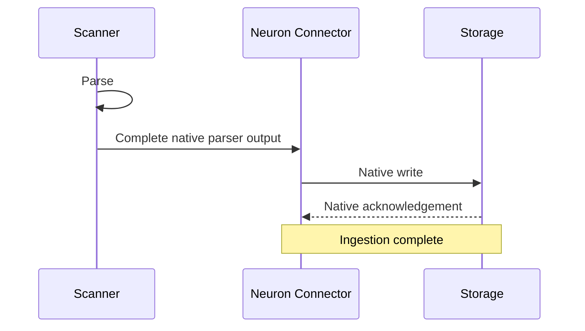

# Native ingestion contract — Parse → Emit

## Purpose and scope

JITK makes existing information available for discovery, retrieval and intelligent use. Original sources are authoritative; database representations are reconstructable projections. This contract describes native ingestion when an application uses a Scanner and a destination-specific Neuron Connector. It does not make ingestion infrastructure a requirement of the standalone Knowledge Positions SDK.

## Architecture

```text
Scanner ────────> Neuron Connector ────────> Storage
 Parse                  Emit                  Store
```

- **Scanner:** universal, destination-independent. Scans sources, parses using established native parsers and supplies everything the parser produces.
- **Neuron Connector:** destination-specific. The emitter itself, not a container for a separate mapper, writer or receiver. Serializes supplied information losslessly as required by the destination's native interface and emits it.
- **Storage:** stores information using its native capabilities and acknowledges its own writes.

Different destinations can use different Neuron Connectors with the same Scanner.

## Functional contract: Parse → Emit

There are two ingestion functions: parse and emit. Serialization is part of emitting, not a separate transformation or mapping stage. The Neuron Connector is a pass-through, not a knowledge processor.

If the scanner supplies ten properties, all ten must reach storage. Preserve supplied values, types, structure, ordering, relationships, coordinates, diagnostics, metadata and binary information. Do not filter, truncate, summarize, normalize away information, interpret, infer, enrich or choose which properties matter. Use native serialization where available; any representation change must preserve the supplied information. Do not substitute debug strings or original source copies for information lost in serialization. Do not claim fidelity for information the native interface cannot expose.

## Runtime



On successful native acknowledgement, the operation ends. No read-back, verification query, extra confirmation write, admission record, separate receipt report or acknowledgement processor belongs in this path. Ordinary exception handling applies only when required: handle native errors; retry when the destination establishes that the prior write had no effect and is retryable; do not blindly replay an unknown outcome. Preserve the destination's authorization boundaries.

Use the destination's established efficient native write mechanisms. Do not introduce per-record requests or commits when native batching can preserve the same information. Performance is an implementation acceptance concern, not an additional runtime stage.

## Knowledge Positions boundary

After information is stored, the KP Writer independently creates representative Knowledge Positions from the stored information. The KP Enricher independently maintains and enriches those records. Neither participates in native ingestion; ingestion does not wait for either. The SDK's shared-identity, location, relation and proximity contracts apply to the knowledge representation, not as a filter on native parser output.

## Different perspectives, one architecture

| Perspective | Description |
|---|---|
| Architecture | Scanner → Neuron Connector → Storage |
| Functional | Parse → Emit |
| Runtime | Parser output → Native write → Storage acknowledgement |
| Runbook | Execute the Scanner with the appropriate Neuron Connector and destination. |
| Environment | Where the Scanner, Neuron Connector and destination are installed, configured and invoked. |
| Implementation | Native parsing, lossless serialization and native writes. |

A command, MCP tool or host integration can invoke the same capability; these are execution paths, not new ingestion architectures.

ETL and ELT are useful industry comparisons, but neither precisely describes this ingestion contract. Retire “Parse → Transform → Emit” and “Receive → Map → Emit” as functional descriptions of this path. Receiving and serialization are inherent in emitting. Do not introduce a separate mapper or writer into ingestion.

## Permanent mission

Speed beats everything. Sources are durable. Projections are disposable. Losing the database should be an inconvenience, not a disaster. If rescanning is faster than recovery, rescan. The database is a map of the knowledge, not the knowledge itself. Ingestion should be so fast and ordinary that the human never needs to think about it.

**Parse → Emit.**

## Status

This is the agreed architecture contract, not a claim that a particular installed Scanner, Neuron Connector or database deployment conforms to it. Implementation and conformance evidence must be established separately. Historical examples of direct SDK capture or native-to-common projection remain distinct from this native ingestion path.
