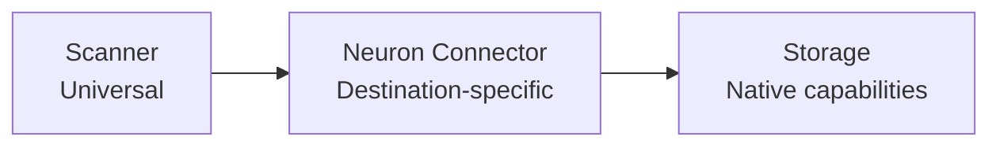
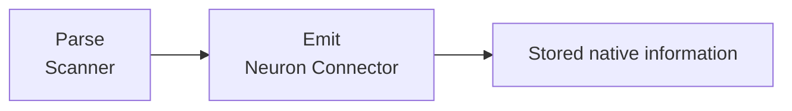
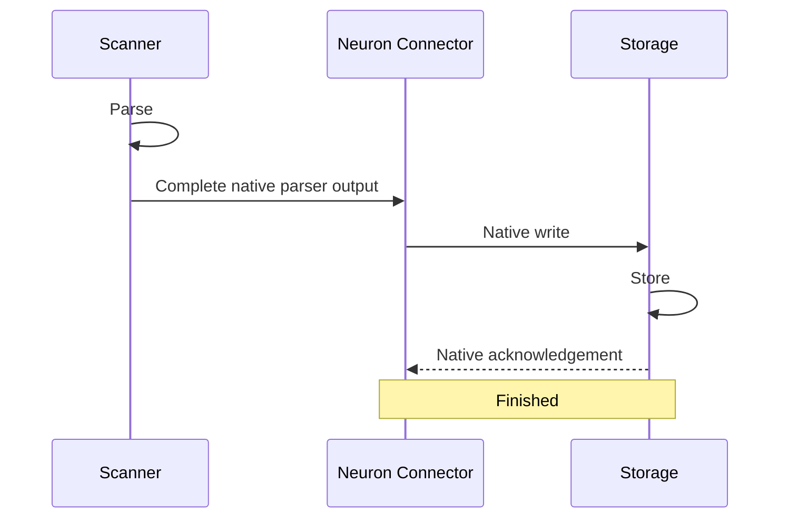
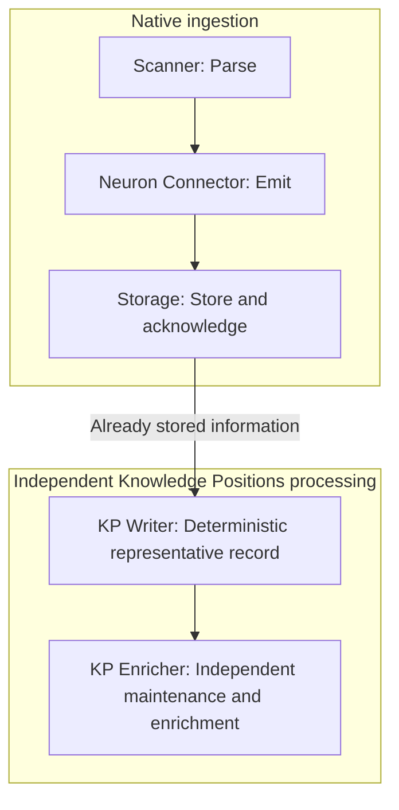
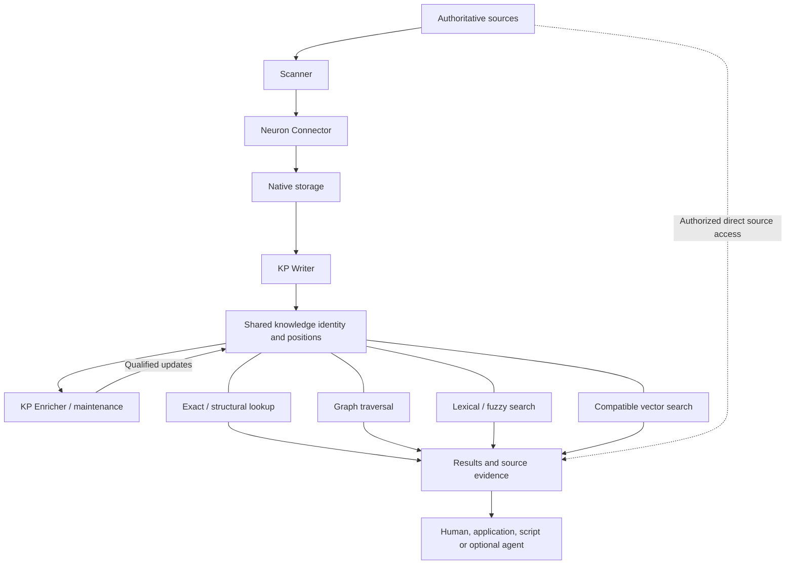

# Understanding Just-in-Time Knowledge — architecture, ingestion and independent retrieval

## Purpose

Just-in-Time Knowledge (JITK) makes accumulated information available for discovery, retrieval, reuse and intelligent work. Original sources remain authoritative. Storage and knowledge representations are reconstructable projections. The goal is to make reconstruction fast, inexpensive and ordinary, rather than make a database indispensable.

The [research paper](../research/paper.md) explains the broader endeavor. The [Knowledge Positions SDK](../README.md) provides an optional shared-identity representation within JITK. The [native ingestion contract](../contracts/native-ingestion.md) specifies the ingestion boundary. This guide explains how those pieces fit together for a newcomer.

**None of the core mechanisms requires an LLM.** A human, application, script or agent can use the same capabilities. Parsing, emitting, storing, deterministic knowledge projection, graph traversal, exact lookup, fuzzy matching, lexical search and ordinary maintenance can operate independently of model inference. Optional semantic contributions by an LLM do not define or control the system.

## 1. Architecture — what exists

| Architectural entity | Responsibility |
|---|---|
| Scanner | Scans and parses sources using established native parsers. Supplies everything the parser produces. |
| Neuron Connector | Serializes and emits everything supplied by the Scanner through the destination's native interface. |
| Storage | Stores the information and acknowledges its own writes. |

The Scanner is universal and destination-independent. The Neuron Connector is destination-specific; different destinations can use different connectors with the same Scanner. Storage is infrastructure, not another custom processing component. OmniGraph is one possible destination, not the definition of JITK.

## 2. Functional description — what we do

**Parse → Emit**

There are two active ingestion functions: parsing and emitting. There is no transformation stage, mapping stage or independent loading component. Serialization is an implementation requirement of emitting information, not a separate functional responsibility. The Neuron Connector is the emitter; it is not a container for independent receivers, mappers and writers.

If the parser supplies ten properties, all ten reach storage. Changing representation to meet the destination's native interface is permitted; changing substance is not. Preserve native structure, types, ordering, relationships, coordinates, metadata, diagnostics and binary values. Do not filter, truncate, summarize, infer or enrich. Use established native serialization and efficient native write capabilities. The [normative contract](../contracts/native-ingestion.md) governs details and exceptions.

## 3. Runtime — what happens during execution

1. The Scanner parses.
2. The Neuron Connector emits.
3. Storage stores and acknowledges.
4. The operation ends.

No read-back, additional verification query, confirmation record or acknowledgement write follows a successful native acknowledgement. Only an actual failure requires exception handling. Retry only when the native interface establishes that the previous operation had no effect and is retryable; handle uncertain outcomes using established destination mechanisms, not blind replay.

Efficient batching and serialization belong within emitting, not as new stages. Acceptance tests and performance measurement are external development activities, not additional runtime duties.

## 4. Correct terminology across documentation

| Perspective | Description |
|---|---|
| Architecture | Scanner → Neuron Connector → Storage |
| Functional | Parse → Emit |
| Runtime | Parser output → Native write → Storage acknowledgement |
| Runbook | Execute the Scanner with the appropriate Neuron Connector and destination. |
| Environment | Actual installation locations, configuration and invocation. |
| Implementation | Native parsing, lossless serialization and native writes. |

These describe the same capability, not different architectures. A shell command, MCP tool or host hook can invoke the same implementation. A connector may have a writer implementation internally without creating a separate architectural component.

### Retired descriptions for native ingestion

| Retired description | Reason |
|---|---|
| Parse → Transform → Emit | No transformation stage. |
| Receive → Map → Emit | Receiving and serialization are inherent in emitting. |
| Mapper as a separate ingestion component | The Neuron Connector emits directly. |
| Writer as a separate ingestion component | The Neuron Connector already writes. |
| Confirmation processor | Storage acknowledges its own writes. |
| Read-back verification as a normal stage | Successful native acknowledgement ends ingestion. |
| Neuron alone as the architectural label | Neuron Connector makes its purpose intelligible to newcomers. |

ETL (Extract → Transform → Load) and ELT (Extract → Load → Transform) are useful industry comparisons, not precise descriptions of this contract. Downstream knowledge processing is not an ingestion transformation. Historical direct SDK capture and native-to-common projection examples are separate contexts; they do not override this boundary.

## 5. Where Knowledge Positions begins

Native ingestion is complete when storage acknowledges its write. It does not wait for Knowledge Positions.

- **KP Writer:** independently creates a representative Knowledge Positions record from information already stored. Initial projection is deterministic; it does not reparse the original source, introduce inference or require an LLM.
- **KP Enricher:** independently maintains and enriches records. Deterministic work uses existing source-backed values, relationships and algorithms. Optional human or model discoveries can be admitted with evidence, but neither is required to execute ordinary maintenance.

These four application components (Scanner, Neuron Connector, KP Writer, KP Enricher) are separated by native storage. The SDK is not itself a mandatory ingestion service or scheduler.

### One identity, many usable positions

Knowledge Positions preserves one source-backed identity and its available values in an OKF-compatible record. See the [common-record contract](../contracts/common-record.md), [positions contract](../contracts/positions.md) and [research paper](../research/paper.md).

| Position | What it enables |
|---|---|
| Location / structural position | Resolve original source, version, path, span, native hierarchy and coordinates. |
| Relation | Traverse observed or qualified relationships, containment, dependencies and other recorded edges. |
| Proximity | Find or rank candidates using available lexical, fuzzy or compatible vector values. |
| Resonance | Research extension for usage and touch signals; not a prerequisite to retrieval or a claim of implemented conformance. |

These are complementary aspects of one record, not separate knowledge stores or sequential processing stages. Unknown values remain unknown. A method may use the values it needs without requiring the other methods to run.

## 6. Understanding the greater JITK architecture

JITK is broader than Knowledge Positions. Existing native search and direct source access can also be used without a common Knowledge Positions representation. Knowledge Positions strengthens continuity across methods where a compatible shared identity exists.

The arrows between a record and retrieval methods are alternative access routes, not a pipeline. An investigator can begin with any supported method, stop when the answer is sufficient or pivot to another method using the same identity. No LLM is required to make this navigation possible.

### Example: answering without an LLM

Suppose an application needs to find where a function is defined and which recorded functions call it.

1. A lexical or fuzzy search finds candidate function names and their source-backed identities.
2. NetworkX, a native graph query or ordinary adjacency traversal finds the recorded caller relationships.
3. A source locator returns the exact file and span if requested.
4. Return the matching names, paths, count and relationships directly as structured data.

The answer is the result of ordinary computation. No model needs to interpret a prompt, invent a relationship or generate prose. The same principle applies to a recipe count, dependency list, document link lookup or exact source-span retrieval. A free-form question that requires semantic interpretation may benefit from an optional model, but that is a consumer capability, not a requirement of the knowledge system.

Available retrieval mechanisms include:

| Mechanism | LLM-independent operation |
|---|---|
| Direct access | Resolve and read an authorized exact source location. |
| Native structural search | Navigate an AST, DOM or parsed document structure. |
| NetworkX / graph queries | Traverse recorded edges, calculate paths, neighborhoods and graph measures. |
| Lexical / fuzzy search | Match names or text using ordinary string and index algorithms. |
| Vector similarity | Compare existing compatible vectors; deterministic lexical encoders can also operate without an LLM. |
| Filters and aggregation | Return matching identities, counts and recorded values. |

A learned embedding encoder may be optional; its absence must not prevent supported structural, graph, exact or lexical retrieval. Do not confuse a model-based encoder with a required generative LLM.

The [retrieval contract](../methods/retrieval.md) describes method choice and evidence. The [component inventory](component-and-capability-map.md) identifies existing APIs. The [standalone example](../examples/sdk_first_use.py) runs with embeddings deferred, without an LLM or database server. The [graph operations example](../core_operations.py) uses NetworkX and NumPy over saved knowledge. These are existing SDK capabilities, not proof of the complete external ingestion deployment.

### Background operation and the role of intelligence

The intended host deployment runs ordinary ingestion, deterministic projection and maintenance in the background, independently of the human's interactive task and an LLM deciding to call a tool. Bind established host execution boundaries, scheduled work or ordinary source events as appropriate. No generative model is required in that execution path.

An LLM may consume retrieved evidence, formulate a search, or contribute qualified discoveries from actual work. It is not the scheduler, parser, connector, database, required query executor or gatekeeper for knowledge maintenance. Human and programmatic consumers must be able to obtain supported results without it.

Background automation is a deployment responsibility, not proof that a standalone SDK install starts workers or installs hooks. The current deployment's actual automation, latency and conformance must be demonstrated separately. See [Environment](../ENVIRONMENT.md) and [Runbook](../RUNBOOK.md).

### Relationship to the paper, SDK and skill

| Part | Purpose |
|---|---|
| JITK research and [paper](../research/paper.md) | Explain and test the broader method of making knowledge available just in time. |
| Knowledge Positions [SDK](../README.md) | Define the portable shared-identity representation and operations, with implementation evidence distinguished from the contract. |
| [Native ingestion contract](../contracts/native-ingestion.md) | Establish Parse → Emit and the separation from downstream processing. |
| [JITK skill](../skills/knowledge-positions/SKILL.md) | Optional instructions for agents using available capabilities; not a prerequisite for execution. |
| [Evolution specification](../Knowledge-Asset-Evolution-Spec-v1.6.3.md) and [relationships and enrichment](../Knowledge_Graph_Relationships_and_Enrichment.md) | Govern portable assets, lifecycle and qualified enrichment rather than native ingestion. |

## Permanent mission

Speed beats everything.

Sources are durable. Projections are disposable.

Losing the database should be an inconvenience, not a disaster.

If rescanning is faster than recovery, rescan.

The database is a map of the knowledge. It is not the knowledge itself.

Ingestion should be so fast and ordinary that the human never needs to think about it.

**Parse → Emit.**

## Status and scope

This is the agreed architecture and intended operational behavior. It does not certify a particular Scanner, Neuron Connector, database, KP Writer, KP Enricher or background integration. The existing Python library implements a subset of SDK capabilities; the external Rust deployment and live database require their own evidence. No LLM dependency or additional processing service is introduced by this document.
