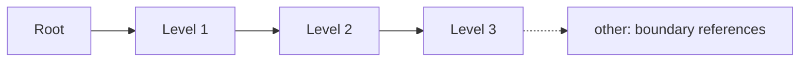
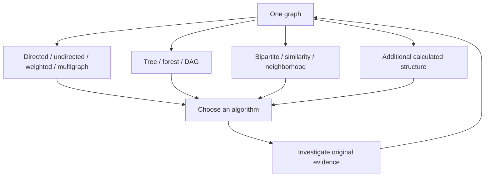
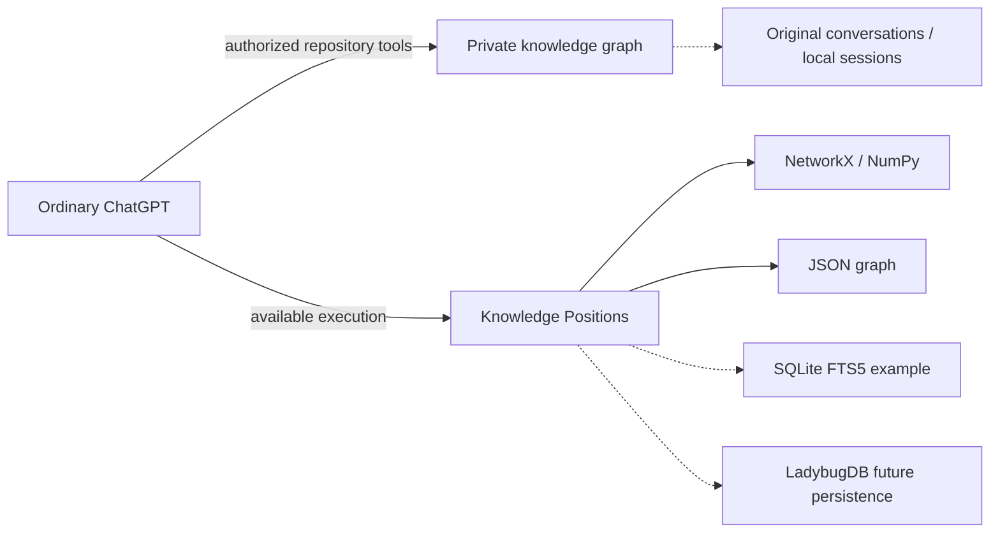

# Architecture in motion — companion to the research paper

We started by trying to save tokens. Then we found the bigger bill: paying to learn what we already know. We are not indexing all human knowledge. We are working with conversations: the decisions, evidence and relationships that make the next investigation possible.


## View A — Representation

```text
 ORIGINAL CHAT (authoritative)
             |
 CORE: location / relation / proximity
             |
 RETRIEVABLE KNOWLEDGE  ---> CURRENT WORKING CONTEXT
             ^                         |
             +---- qualified findings-+
```

Original information, its retrievable representation, model understanding and live working context are distinct. Preserve source addresses and hashes. An unknown vector is null, not an invented coordinate.

## View B — Retrieval density



Stop at three hops. Retain the fourth-hop frontier in other, without traversing or loading deeper knowledge. This is a retrieval ceiling, not a deletion rule. Full graph algorithms and dependency invalidation remain unrestricted. Depth three is an engineering choice, not a demonstrated universal optimum; wide graphs can still return many nodes.

## View C — Graph freedom



The ten named views are conveniences. If a different graph helps, calculate it. Condensation and line graphs have already been exercised. A graph property is not proof of a factual claim.

## View D — Runtime and network



[SQLite](https://www.sqlite.org/) supplies the [FTS5](https://www.sqlite.org/fts5.html) lexical-index example. [LadybugDB](https://docs.ladybugdb.com/) is a possible embedded graph persistence backend. Neither is a new mandatory dependency. Ordinary ChatGPT participates through its available authorized tools, rather than a modified model or provider memory system. Cross-domain pointers do not imply original-source access or transfer ownership; [source realm and access signals](../LOCATION_ACCESS.md) must be resolved per environment, with separately protected private source stores. Structural ingestion can precede and outnumber semantic enrichment: **an LLM enriches on actual use/read, not on initial corpus ingestion**. Bound semantic work to at most three useful contextual levels (this is distinct from the three-hop working-context retrieval ceiling). An explicit bulk offline enrichment run is a separate opt-in policy.

**We did not invent cascading staleness.** We learned it from [Garyu-tt/noosphere-lite-mcp](https://github.com/Garyu-tt/noosphere-lite-mcp). Explicit dependents are marked stale when evidence changes; derived conversation caches are cleared. History remains inspectable. Nine regression tests passed against the current code, including depth-three retrieval, direction and relation filtering, and a cascade extending beyond the retrieval ceiling.

Our engineering assessment is that the library gets us roughly 95% of the way to the basic mechanics of JIT memory. The rest is architecture and execution. That percentage expresses our design judgment, not measured token savings or benchmark coverage. The independent Git submodule is a deployment step still to be completed. Each intelligence keeps its own knowledge and an agent reminder; local source access is separate. Database security and encrypted credential management are future work.
