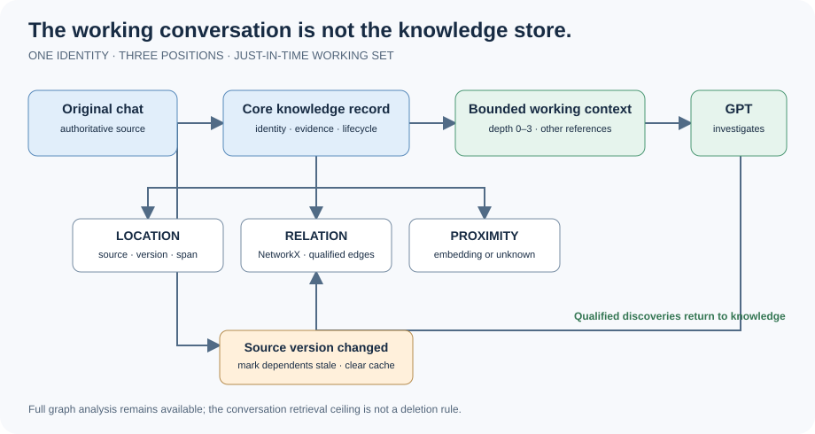
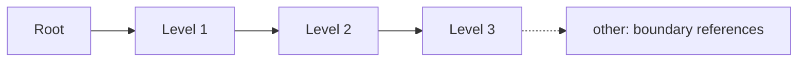
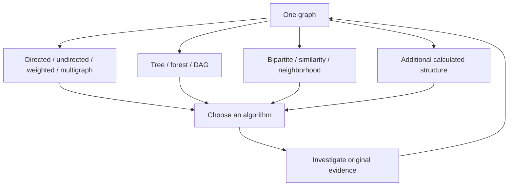
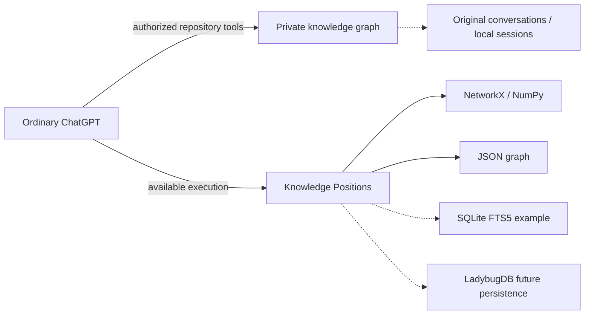

# Architecture in motion — companion to the research paper

We started by trying to save tokens. Then we found the bigger bill: paying to learn what we already know. We are not indexing all human knowledge. We are working with conversations: the decisions, evidence and relationships that make the next investigation possible.



## View A — Representation

```text
 ORIGINAL CHAT (authoritative)
             |
 CORE: location / relation / proximity
             |
 RETRIEVABLE KNOWLEDGE  ---> CURRENT WORKING CONTEXT
             ^                         |
             +---- qualified findings-+
```

Original information, its retrievable representation, model understanding and live working context are distinct. Preserve source addresses and hashes. An unknown vector is null, not an invented coordinate.

## View B — Retrieval density



Do not impose a fixed hop ceiling on working-context retrieval. The default implementation uses Personalized PageRank / random-walk-with-restart attenuation from the root and exposes a conservative/balanced/aggressive dial through transparent score thresholds. If radius itself is the intended graph operation, use an explicit ego-graph radius. `other` retains immediate excluded neighbors as boundary references. Full graph algorithms and dependency invalidation remain unrestricted.

## View C — Graph freedom



The ten named views are conveniences. If a different graph helps, calculate it. Condensation and line graphs have already been exercised. A graph property is not proof of a factual claim.

## View D — Runtime and network



[SQLite](https://www.sqlite.org/) supplies the [FTS5](https://www.sqlite.org/fts5.html) lexical-index example. [LadybugDB](https://docs.ladybugdb.com/) is a possible embedded graph persistence backend. Neither is a new mandatory dependency. Ordinary ChatGPT participates through its available authorized tools, rather than a modified model or provider memory system. Cross-domain pointers do not imply original-source access or transfer ownership; [source realm and access signals](../LOCATION_ACCESS.md) must be resolved per environment, with separately protected private source stores. Structural ingestion can precede and outnumber semantic enrichment: **an LLM enriches on actual use/read, not on initial corpus ingestion**. Semantic payload mutation has a hard three-touch budget per node or explicit cluster: admission is touch 1, touches 2 and 3 may revise the payload, then it freezes until verified source mutation starts a new epoch. Later discoveries grow outward through relationships. Retrieval breadth is separate and graph-theoretically bounded. An explicit bulk offline enrichment run is a separate opt-in policy.

**We did not invent cascading staleness.** We learned it from [Garyu-tt/noosphere-lite-mcp](https://github.com/Garyu-tt/noosphere-lite-mcp). Explicit dependents are marked stale when evidence changes; derived conversation caches are cleared. History remains inspectable. Regression coverage now includes adaptive PPR retrieval profiles, explicit ego-radius retrieval, direction/relation filtering, three-touch enrichment freezing, and dependency cascades that remain independent of retrieval scope.

Our engineering assessment is that the library gets us roughly 95% of the way to the basic mechanics of JIT memory. The rest is architecture and execution. That percentage expresses our design judgment, not measured token savings or benchmark coverage. The independent Git submodule is a deployment step still to be completed. Each intelligence keeps its own knowledge and an agent reminder; local source access is separate. Database security and encrypted credential management are future work.
