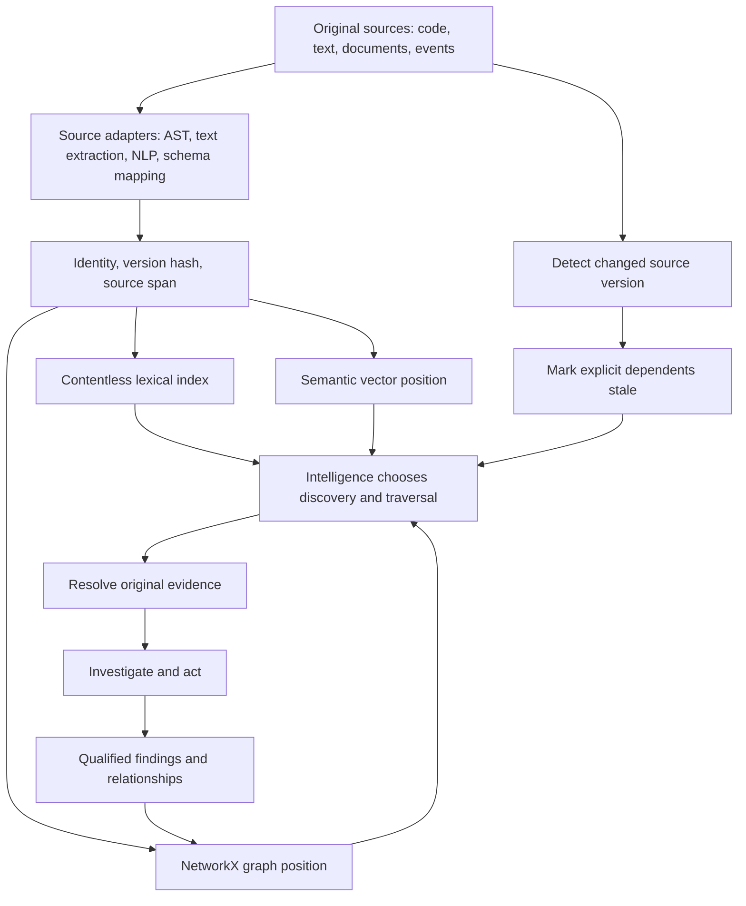
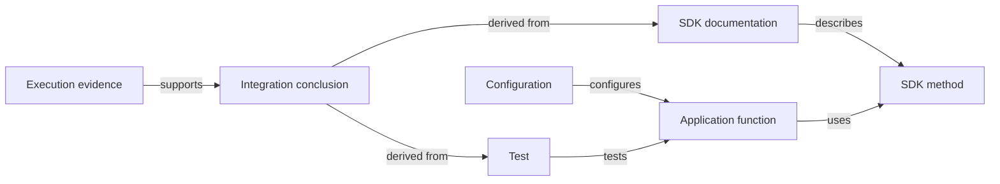
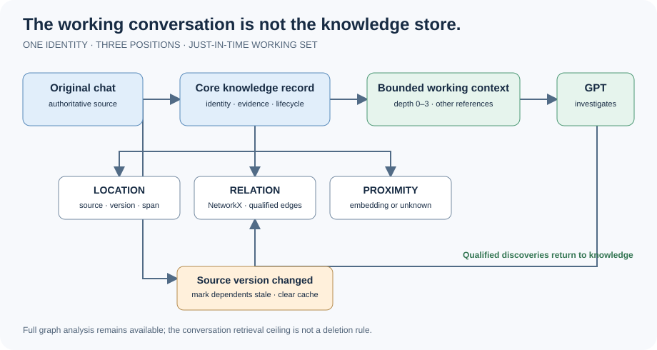
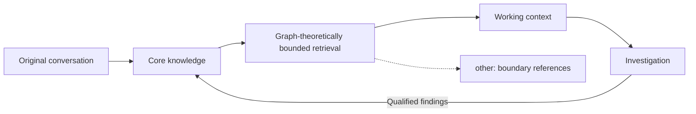
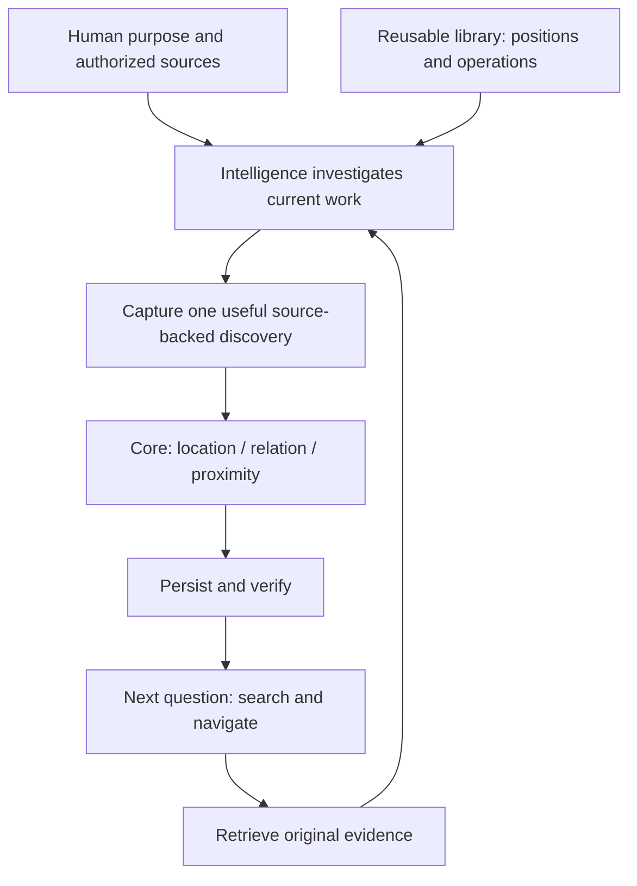

# Just-in-Time Knowledge: Beyond the Context Window

**Albert Mowatt — Working research manuscript, November 10, 2026**  
Research draft; not peer reviewed or submitted. Author approval required before submission.

## Abstract [EKC:01]

The original question behind this research was straightforward: how can we reduce the tokens consumed by large language models without sacrificing the intelligence needed to accomplish a task? The investigation led to a different question: why do we continually ask an intelligence to read information that another intelligence has already read, understood, connected, and used?

This paper proposes Just-in-Time Knowledge (JITK), an approach that separates the knowledge an intelligence can access from the information it must carry in its current context. Knowledge has three interoperable positions: its location in an original source, its semantic vector position, and its relationships in a graph. An intelligence uses these positions to discover and retrieve original evidence, construct its own investigative graphs, and preserve useful discoveries for later intelligences.

We introduce Knowledge Positions, a lightweight Python reference implementation. In a preliminary experiment, a fresh language-model session received a navigation package derived from 28 selected conversation passages while the source file was withheld. The model searched the index, followed relationships, requested four source passages, and answered a question from those passages. The experiment demonstrates the mechanics of selective knowledge navigation across sessions; it does not measure token savings, retrieval accuracy at scale, or automated enrichment. We articulate those open questions rather than claim to have solved them. The central proposition is that a context window is a temporary workspace, while knowledge is a persistent resource that can evolve through use.

**Keywords:** just-in-time knowledge, context management, retrieval-augmented generation, knowledge graphs, provenance, agent memory, source grounding.

## 1. The problem we started with [EKC:02]

When an AI coding assistant begins a new conversation, the human often supplies a repository, a specification, earlier decisions, and a description of what has already been accomplished. The assistant reads them. It makes connections. It does the work. Then the context clears, the model changes, or a new session begins. The human and the assistant repeat much of the same activity.

We started by trying to save tokens. Then we found the bigger bill: paying to learn what we already know.

There are good reasons to reread material. An implementation may have changed. A question may require a different interpretation of the same source. A previous conclusion may have been wrong. But repeating the work of locating a stable SDK method, discovering its relationship to a project, and reconstructing why a tested design was selected is a different category of expense. Much of that work is potentially reusable.

An information system would not normally solve this problem by asking every process to load every file in a repository. It uses names, addresses, indexes, relationships, caches, and version checks. A capable process can use a small working set while the rest of the information remains accessible. The intelligence should have that same option.

The first phase of our inquiry was context surgery: what is the smallest context that retains the ability to perform a task? Instead of attempting to remove tokens from a long existing context, we considered the limiting case: a fresh context. We then asked what the intelligence must be able to access in order to reconstruct the necessary working knowledge.

The answer is not that a model needs no context. A model needs a question, instructions, working evidence, and the results of its investigation. The answer is that the model need not carry the entire history of how that evidence became known.

The proposition of this paper is therefore:

> Do not make the intelligence carry everything it may need to know. Make everything it may need to know navigable.

This is an engineering proposition, not an assertion that we understand internal model cognition. Language models already exhibit substantial ability to formulate search queries, inspect results, reason about relationships, and decide what evidence is missing. We exploit that capability instead of building an additional reasoning system to decide every retrieval operation on their behalf.

### 1.1 What we are and are not claiming [EKC:03]

Retrieval-augmented generation, external memory, graph retrieval, and agent-directed tool use are established ideas. We do not claim to have invented them. Our contribution is a particular integration and an inspectable experiment: source-addressed knowledge, independently usable semantic and graph positions, agent-selected graph construction, preservation of original evidence, and incremental enrichment as a single lifecycle.

The goal is not to replace large context windows, eliminate tokens, or prove that all tasks benefit from retrieval. It is to test whether the cost of recovering a working understanding can be reduced by retaining the results of prior investigations outside the context window.

Prompt caching, compression, and longer windows remain legitimate alternative or complementary approaches. Our proposed measure of success must include total token use and tool overhead, not only the size of the initial prompt.

## 2. Knowledge, context, and the three positions [EKC:04]

We distinguish four things:

| Term | Meaning in this paper |
|---|---|
| Source | Original text, code, document, event or other evidence at an identifiable version. |
| Knowledge | A source-backed observation, relationship or qualified interpretation that can be reused. |
| Context | The information available to a model for a particular inference. |
| Index | A derived navigational representation used to find knowledge; not a substitute for the source. |

A knowledge item need not be a paragraph. It can be a function, an API contract, a test result, a decision, a passage in a book, or a relationship between them. The unit should be selected for usefulness, not a mandatory universal chunk size.

Let a source version be S = (u, h), where u is its resolvable address and h is a digest of its bytes. A knowledge node k has an identifier i, source coordinates p, a vector v and graph membership:

    k = (i, S, p, v, metadata)
    G = (V, E), where i belongs to V.

The source position is (u, h, p); the vector position is v; the graph position is the node's identity and its relationships in G. An edge can include its direction, type, evidence and qualification. This notation is a conceptual contract, not a required database schema.

| Position | Question answered | Example |
|---|---|---|
| Source | Where exactly is the evidence? | Repository, commit, file, line/column span |
| Vector | What is semantically near this item? | Embedding from a specified model |
| Graph | What is connected to it, and how? | An implementation uses an SDK method |

The three are complementary. A vector may locate a concept without explaining why two facts are connected. A graph may show a connection without carrying the original evidence. Source coordinates make that evidence retrievable without guessing which text was meant.

We call this the GPS analogy. The map is not the destination. A coordinate identifies a destination; a route describes how to reach it. If a source no longer exists and no preserved version is available, neither a graph nor a digest can reconstruct its exact content.

### 2.1 Source positioning [EKC:05]

The Python abstract syntax tree provides a useful precedent: nodes representing source constructs can carry beginning and ending line and column coordinates. The source file identity and version must be supplied separately. For Python AST, column offsets are UTF-8 byte offsets; other source adapters may use byte ranges, page/region coordinates or time spans.

A second *within-item* structural layer describes a node's ordered path, ancestor/parent placement, sibling index and depth. This is **the AST positioning technique**, not a requirement to parse all information as Python AST. An existing Python source adapter can compute these coordinates deterministically on read; document/HTML parsers can supply equivalent paths. For any source, the representation prefers the strongest actually verified method: native structure, then stable anchors, then version-scoped spans (including ordinary line/byte positions); retain useful secondary coordinates. Model-supplied descriptive clues remain provisional, not a universally required paragraph-numbering scheme. A novel coordinate method can be recorded as a shared provisional convention so later readers use the same meaning rather than inventing an incompatible one. Maintenance belongs to the library and its host/read/watchdog integration, not to optional LLM instructions. Such structure may be included in a separately declared positional embedding input representation; metadata alone does not modify existing vectors.

**One evolving theory, one source of authority.** Knowledge Positions can preserve one verified source location together with complementary coordinates. Prefer source-native structure when available, then stable identifiers/anchors, then versioned byte/line/time spans; retain lower-priority verified coordinates rather than manufacturing a hierarchy. A model's unverified clue stays provisional. A novel format should reuse this same library method or register one provisional, reusable convention—not fork the paper or create competing locator schemas. The existing graph is a navigational projection of the current evidence, and historical snapshots are not parallel authorities. A source-read adapter or watchdog invokes deterministic maintenance; an LLM may propose meaning or a locator but does not own maintenance.

We adopt the idea of a source-relative, versioned span as a general convention. We do not require every source to be parsed as Python, or require every graph to be a syntax tree.

A source locator is not an access grant. Precise location can include an owning namespace, stable source ID, observed version and verified span, plus a *separate* realm and possible retrieval routes. The current caller must establish reachability and discover/read/write permission in its own environment. A knowledge graph may point to private chats, authenticated services, SSH-only machines or public pages without claiming that every intelligence can open them. Missing coordinates remain unresolved leads. See the [portable location and OKF design](../LOCATION_ACCESS.md).

For a codebase, a parser may produce syntax containment and exact spans. For a PDF, an extractor can retain page and region mapping. For language, token offsets, named entities, parts of speech and dependency relations can provide initial structure. For an event stream, sequence and time can identify an observation. The adapter supplies what is known; the graph need not invent the rest.

### 2.2 Vector positioning [EKC:06]

A semantic embedding locates an item in a learned representation space. We propose that each ingested item receive such a position even if vector search is not currently needed. In the reference library, the configured Sentence Transformers model is all-MiniLM-L6-v2; the model identity must accompany the vector. Vectors generated by different models or incompatible preprocessing cannot be assumed comparable.

The vector is a discovery aid, not a factual assertion. Similarity is neither causality nor equivalence. When a source remains unchanged, its existing representation can be reused, subject to model-version compatibility.

The actual experiment used deterministic 512-dimensional hashed lexical vectors because the semantic model was unavailable. That distinction is material: the experiment tests navigation mechanics, not semantic retrieval.

### 2.3 Graph positioning [EKC:07]

A graph position is defined by node identity and relationships, not by coordinates in a visualization. NetworkX supplies the ordinary graph structures and algorithms needed for this work. A tree is one possible graph. A directed dependency graph, undirected graph, multigraph, weighted graph, bipartite graph, DAG, or similarity graph is another useful perspective.

The intelligence should choose the graph appropriate to the question. A parser may identify a syntax tree, but the agent may need to connect an SDK to a function, a test to a result, and a design decision to a passage from a book. No syntax tree alone defines those relationships.

The reference implementation uses a directed multigraph as a persistence representation. Agents may construct other graphs, project selected edges, and choose their own traversal using NetworkX. We do not propose a new graph-search engine. We propose access to the graph and the evidence needed to interpret it.


## 3. Architecture: knowledge that grows through work [EKC:08]

The architecture begins with sources and ends with a richer, navigable knowledge space. Its most important feature is the return path: an investigation is not finished when an answer is generated. A useful relationship discovered during the investigation may become part of the knowledge available to future investigations.



**Figure 1.** Proposed architecture. Source adapters, semantic embeddings, generalized enrichment and cascading invalidation describe the intended lifecycle; the reference implementation and pilot realize only part of it.

The intelligence may initiate a deterministic lookup, choose exact or fuzzy search, ask for semantic neighbors, or create its own graph traversal. The execution of a database query or graph algorithm need not be another language-model inference. The division of labor is deliberate: let the model formulate the investigation; let ordinary code execute the operations.

### 3.1 Search before enrichment [EKC:09]

A historical collection may contain years of documents. It is expensive to ask a model to read, summarize and organize every document before any of them can be found. We distinguish discovery from permanent enrichment.

A lightweight lexical index can be created by scanning accessible source text. SQLite FTS5 supports contentless tables [7], which retain searchable index structures without storing the original text in the FTS table. A row identifier maps a match to a source address and span. The source stays in its existing authoritative location.

    CREATE VIRTUAL TABLE search USING fts5(text, content='');

This does not mean SQLite can search a file it has never seen. An unindexed source must first be found and scanned by an appropriate mechanism, such as a file search, text extraction or on-demand indexing. Nor does a contentless index mean no information is stored: terms, frequencies, positions and other derived metadata can expose content. It is not a privacy boundary.

There are thus at least two economically different operations: discovering a source and performing deeper enrichment. The latter is not required for every historical document before the first useful search.

**Ingestion is not enrichment.** A source-specific parser can index the AST, file boundaries, structural edges, hashes and exact positions of an entire codebase without an LLM interpreting every file. In the normal JITK workflow, semantic enrichment happens **when work actually touches a source and the intelligence has already read it**. Only then should useful summaries, supported concepts and qualified cross-source relationships be retained. Opening a repository, scanning a large archive or completing an AST pass must not trigger a corpus-wide LLM enrichment job. An explicit offline bulk-enrichment task is possible, but a different application policy, not this default architecture.

For structured data, an adapter can map existing schema fields and identifiers into the common representation without asking an LLM to reread every record. For unstructured data, language tools such as spaCy can supply tokens, grammatical structure, entity candidates and offsets. Such outputs are fallible observations about text, not automatic proof of meaning. Human-readable Markdown and OKF-compatible assets can provide portable representations; the format is not a graph engine.

### 3.2 Three modes of access [EKC:10]

| Mode | Input | What the intelligence does |
|---|---|---|
| Known destination | Stable source or knowledge addresses | Retrieves the specified evidence. |
| Unknown destination | Question, partial name or concept | Chooses search and graph traversal until it finds relevant evidence. |
| Continuing investigation | Existing working graph and discoveries | Follows new relationships, checks sources, updates its understanding. |

A fresh context can be supplied with addresses for the mission, architecture, current task and established decisions. It retrieves their contents when needed. Alternatively, a user asks a question and the intelligence discovers those addresses itself. An optional deterministic seed retrieval may reduce startup overhead, but a mandatory pre-inference reasoning pipeline is not required.

The pilot tests the second mode. The first is an obvious technical possibility, but an independently measured address-only handoff is left as a follow-up.

## 4. From retrieval to evolving knowledge [EKC:11]

A useful graph should accumulate the results of intellectual work, not merely the words that were available before that work.

Suppose an intelligence is examining a software development kit. It reads the SDK and an application codebase and discovers that a particular application function calls an SDK method under a particular configuration. It identifies the relevant documentation, test and execution result. The relationship between those sources may not be expressed in any single document.

That relationship is knowledge. It can be retained with its supporting evidence and become a starting point for the next investigation.



**Figure 2.** Illustrative cross-source knowledge. These relationships are examples, not findings produced by the pilot. Each source retains its own structure and provenance.

This is not a proposal to manufacture a graph with the maximum possible number of edges. The value of a relationship is its usefulness and its qualification. A specific, supported relationship is more valuable than a large collection of unexplained similarity links. The existing companion specification, *Knowledge Graph Relationships: The Useful 80%*, describes a practical vocabulary for structure, dependencies, execution, evidence, intent and historical evolution [9].

### 4.1 Reuse, hashing and promotion [EKC:12]

Knowledge can be acquired while reading documents, writing code, observing an execution, or answering a question. Explicitly important material may be ingested at once. Repeated use provides a different signal: something the system repeatedly retrieves may deserve a permanent representation or a permanent connection to one that already exists.

We propose a simple experimental policy: more than five retrievals of the same information triggers promotion on the sixth retrieval. This is a proposed heuristic, not an optimality claim. It means the system should stop repeatedly paying for the same discovery or processing work. It does not mean that a frequently retrieved claim is true.

A source version is identified by its content digest. Unchanged material can reuse previous extraction and vector positioning. Newly discovered relationships can be added without rerunning the original source through a model. If an embedding model or extraction algorithm changes, the representation may need rebuilding even though the source has not changed.

Working enrichment uses a **three-touch mutation budget** on a node or explicit cluster. Initial admission/extraction is touch 1; only touches 2 and 3 may revise or thicken that semantic payload. After touch 3 the core freezes. New context must grow outward as new nodes and qualified relationships rather than repeatedly inflating the same record. A verified source-version change begins a new enrichment epoch. This write budget is separate from retrieval: working-context reads use graph-theoretic attenuation rather than a universal hop count. The application must observe the read/touch and reuse material already in context; leaving enrichment as an optional instruction permits the model to skip it.

The earlier Knowledge Asset Evolution profile v1.6.3 [8] describes independent ownership-sensitive hash gates for authored content and machine enrichment. A machine update should not trigger the same enrichment process indefinitely. Those gates are a design reference; the present library does not implement that complete lifecycle.

### 4.2 Knowledge that becomes stale [EKC:13]

New information does not automatically make old information false. But an evolved knowledge system must be able to identify conclusions whose underlying evidence has changed.

Noosphere Lite MCP [10] provides an explicit contribution to this design: cascading staleness along declared derivation relationships. If a source changes, its dependent conclusions can be flagged for revalidation without erasing history.

Let an edge (a,b) of type derived_from mean that a depends on b. For a changed node b, the conservative affected set is:

    A(b) = { x : a directed path from x to b exists in the dependency graph }

NetworkX can compute this set with a reverse dependency traversal, for example ancestors in a directed graph with the stated orientation. Cycles require a visited set; multiple dependencies require retaining the relevant provenance. A stale marker means review is required, not that a conclusion has been disproved. Similarity edges do not carry this consequence by default.

This principle completes a crucial part of the lifecycle: a knowledge web must not only grow, but also remain capable of revising itself. Implementation and validation of this mechanism are pending in Knowledge Positions. Noosphere is credited for the design contribution; its source code was not incorporated.

## 5. Reference implementation: Knowledge Positions [EKC:14]

The reference implementation is intentionally small. It is available in the project repository [6]. Its core is an ordinary Python library.

| Component | Role | Pilot status |
|---|---|---|
| Python AST | Optional Python source spans and syntax-containment extraction | Implemented in library |
| NetworkX | Directed multigraph, relationships, arbitrary graph operations | Used |
| Sentence Transformers / NumPy | Configurable embedding and vector similarity | Semantic path implemented; actual model untested in pilot |
| SHA-256 | Source-version and span identity/integrity | Used |
| SQLite FTS5 | Contentless lexical index | Used in example |
| JSON | Persist graph, vectors and metadata | Used |
| Jupyter / Marimo | Human-facing exploratory notebooks | Supplied; real-model execution pending |

A minimal use of the core library is:

```python
from knowledge_positions import KnowledgePositions
import networkx as nx

k = KnowledgePositions()
ids = k.ingest_python("example.py")
k.save("knowledge.json")
# The investigator may choose its own graph and traversal.
g = nx.DiGraph(k.graph)
```

The core library stores nodes with source identity, version, coordinates, content digest, vector and embedding-model metadata. It stores edges with relation and optional evidence. A separate example provides a contentless text index and source resolver. The library itself does not impose a database, mandatory MCP service, or custom graph-search framework.

The implementation is not a production memory platform. Its graph is in memory, vector retrieval is linear, its persistence format is JSON, and its example creates pairwise shared-term edges. These choices make the mechanisms inspectable, not necessarily efficient at large scale. General document extraction, automatic enrichment, cascading invalidation, and durable multi-agent concurrency are future work.


## 6. Experiment: a cold intelligence navigates unfamiliar knowledge [EKC:15]

### 6.1 Research question and protocol

Can a language model that has not received a source conversation identify the relevant evidence through a navigation package and answer a question after selective source retrieval?

We conducted a small, exploratory, human-mediated trial on November 10, 2026. The source fixture comprised 28 manually selected conversation excerpts. It was representative, not a complete chat export or a random sample of a larger corpus. The fixture is the experimental ground truth for exact retrieval; the experiment does not independently establish that every statement in the fixture is true or reproduce the complete conversation history.

The source holder kept the source text separate. A fresh second model session received a package containing the graph, lexical index, hashed lexical vectors and Python search/traversal tools. It was asked what we had established about connecting an SDK to an application's codebase and why it was useful. It was instructed to identify node IDs and request source passages rather than request the complete transcript. The source holder relayed the requested passages. The model then answered.

The original model identifier, sampling parameters, complete inference transcript and token usage were not recorded as controlled experimental metadata. The session separation is based on the reported experimental setup, not an independently audited provider log. Accordingly, this is a case study, not a blinded randomized evaluation.

### 6.2 Artifact and reconstruction

The original artifact, retained separately from the later GitHub example, was inspected and replayed during manuscript preparation. The archive's SHA-256 is:

    0b89a64820b4b2b716c6e0d13d0cb3b43f2a2e8ba5c979b1a3fcbd15947cc8a1

The source fixture's SHA-256 is:

    c8011e71a141e68d87b740ab138df63e5fe0c8a20f27d1b6100913dde9fb4e02

The original graph index contained 28 nodes, 27 next_passage edges and 15 shared_terms edges. Each node contained a source version, byte span, content hash and 512-dimensional lexical vector. The search used FTS5 and cosine similarity over the hashed vectors. Shared-term links were constructed using overlapping tokens; they were not validated semantic relations.

The GitHub example is a later reproducible implementation of the same experiment. Historical identifiers should not be assumed portable to a rebuilt index unless the source version and identity algorithm are identical. The companion record identifies the original artifacts and records the actual retrieval replay separately.

### 6.3 Results [EKC:16]

The second model reported an initial execution issue caused by Python isolated mode; it corrected its invocation. It searched for SDK/codebase terms, found two exact matches, explored their neighbors, and requested their original passages. It subsequently decided that the evidence was insufficient to explain the usefulness of the connection, followed the immediate upstream and downstream passage relationships, and requested two additional passages.

| Step | Observed behavior | Source passage |
|---|---|---|
| 1 | Initial exact search | The SDK and the codebase become two connected knowledge graphs. |
| 2 | Adjacent matching passage | The SDK and codebase retain their own structures, but their connections become navigable knowledge. |
| 3 | Upstream traversal | The LLM doesn't have to carry the knowledge. It has to know how to reach it. |
| 4 | Downstream traversal | You and the LLM are navigating the same knowledge. |

The four passages were returned by the source holder. During manuscript preparation, all four original IDs were resolved again against the retained fixture and reproduced the passages above. The original search for "SDK codebase" also reproduced the two exact matches and ranked those two nodes first and second in the lexical-vector results.

| Quantity | Replayed artifact measurement |
|---|---:|
| Source bytes | 2,270 |
| Source passages | 28 |
| Graph edges | 42 |
| Sequential edges | 27 |
| Shared-term edges | 15 |
| Requested passages | 4 |
| Requested original span bytes | 288 |
| Retrieved span bytes / source bytes | 12.69% |
| Graph JSON bytes | 218,640 |
| FTS SQLite bytes | 24,576 |


**Figure 3.** Observed investigation sequence. The model selected the additional evidence; the human relayed source text. This figure describes the recorded case, not an automated benchmark.

The final model answer distinguished linking the SDK and codebase from merging them. It explained that each retained its structure and that cross-source relationships became navigable. It identified the value as selective retrieval rather than bulk loading and described shared navigation by human and model. That answer was consistent with the four supplied passages.

This is a modest but important result. The model did not need to receive the original fixture in its entirety to produce a coherent answer about the relationship. It was able to investigate a representation, request evidence and stop when it considered the evidence sufficient.

### 6.4 What the result does not prove [EKC:17]

The experiment does not demonstrate a reduction in total token consumption. The 288 bytes count original source spans, not all prompts, tool responses, identifiers, code, graph metadata, reasoning, or model output. The two indexes together occupy 243,216 bytes, far exceeding the tiny 2,270-byte source. This is an expected consequence of an inspectable JSON vector representation and fixed database overhead, but it also refutes any inference that this fixture demonstrates storage compression.

No comparison with a full-context baseline, conventional retrieval baseline or graph-only baseline was performed. The model knew the target terms in the question, and the manually selected fixture was favorable to lexical retrieval. The experiment asked about the design discussed in the conversation, not an actual SDK/codebase integration. It does not establish correct cross-repository dependency discovery. Neither semantic embeddings nor automatic write-back nor cascading invalidation was tested in this trial.

The model was not deprived of all information about the source: its index contained derived terms, vectors and relationships. The appropriate claim is that the original source text was withheld and selectively supplied, not that the index reveals nothing about the source.

The result supports feasibility of the navigation mechanism. It motivates, but does not verify, a claim about efficiency or scale.

## 7. Independent critique and design reconciliation [EKC:18]

The second intelligence evaluated the fixture after using it. It identified lexical brittleness, noisy shared-term edges, and the possibility that the correct node would not appear among the first results at scale. It suggested combining lexical and semantic rankings, filtering corpus-specific common terms, and providing optional bounded context windows.

These observations are useful because they arise from an actual investigation. They also reveal which parts of the intended design the fixture had not yet implemented.

| Critique | Existing design direction | Remaining technical question |
|---|---|---|
| Lexical search can miss paraphrases | Semantic vectors plus exact and fuzzy discovery | Does real semantic retrieval improve recall without unacceptable false positives? |
| Shared terms are not meaningful relations | Qualified evidence-backed relationship enrichment | How should candidate edges be promoted, disputed and corrected? |
| Domain-common vocabulary generates noise | General lexical and graph discovery | What corpus-aware weighting improves discovery? |
| Top hits may not suffice | Agent-selected traversal and source resolution | What is the best optional hybrid ranking and expansion budget? |
| Adjacent passages add context | Source spans and graph navigation | Can bounded contextual reads reduce tool calls without returning irrelevant text? |

The design does not require an automatic fixed-width expansion for every search hit. In the pilot the intelligence chose the extra passages and stopped. A bounded window is an optional instrument, not a requirement to load additional material.

The most significant missing mechanism became apparent when the critique was compared with the earlier knowledge lifecycle and the Noosphere Lite MCP implementation: cascading staleness through explicit dependencies. That mechanism, described in Section 4.2, remains an implementation task for our library.

The distinction between a discovery edge and an established knowledge edge is central. A shared_terms link may provide a lead. After investigating the source and execution evidence, an intelligence might establish a more precise relationship. Both can exist; they should not be given the same epistemic status. Repeated retrieval increases potential utility, not factual confidence.

## 8. Evaluating the economics of just-in-time knowledge [EKC:19]

We propose a measurement framework rather than a numerical cost claim.

Let C be the token-equivalent cost of providing a full relevant corpus to one fresh session, B the fixed setup and instruction cost, R the evidence tokens retrieved, M the metadata and tool-response tokens, and T the additional investigation tokens. Let I be the one-time cost of indexing/enrichment, expressed in a common cost unit, and U the maintenance cost over n sessions. In a simplified accounting:

    Full-context cost = n × (B + C)
    JITK cost = I + U + n × (B + R + M + T)

A benefit is possible when:

    n × (C - R - M - T) > I + U

The expressions are conceptual, not observed results. A rigorous evaluation must use actual token accounting, model/provider pricing or compute, cache hits, latency, storage, extraction and indexing costs. It must include both successful and failed retrieval attempts. A model that takes ten tool calls to find a short paragraph may be more expensive than a model that reads a relevant document directly.

It is also important to compare answer quality, not merely cost. A less expensive system that misses a requirement or retrieves stale evidence is not necessarily better.

We suggest a small experimental matrix that future researchers can implement independently:

| Condition | Purpose |
|---|---|
| Full relevant source supplied | Baseline answer quality and context cost |
| Lexical or vector retrieval only | Baseline discovery |
| Agent-directed graph navigation | Incremental value of relationship traversal |
| Enriched graph from prior investigation | Reuse of earlier intellectual work |
| Source change with dependency invalidation | Currency and correction |
| Cold address-only handoff | Direct retrieval without a handoff summary |

For each condition record task success against independently specified evidence, evidence recall, incorrect assertions, number of tool calls, total model tokens, latency, index size and construction/maintenance cost. Increase corpus size and distractors while keeping the target questions controlled. Use questions paraphrased away from source vocabulary. Report failure cases, not just examples where the first search succeeds.

A second experimental dimension is the number of sessions. An architecture that is expensive to initialize may become economical after repeated use. The proposed advantage is knowledge reuse over time, so evaluating only one query may miss the central hypothesis.

## 9. Relationship to existing work [EKC:20]

This paper is deliberately focused on the author's design and experiment. The following references locate neighboring ideas without claiming that JITK invented their underlying mechanisms.

| Work | Relevant contribution |
|---|---|
| Retrieval-Augmented Generation [1] | Explicit external retrieval combined with language generation. |
| Lost in the Middle [2] | Evidence that long-context performance can depend on the position of relevant information. |
| MemGPT [3] | Virtual context management through external memory tiers. |
| GraphRAG [4] | Graph-derived representations for corpus-level question answering and summarization. |
| A-MEM [5] | Agentic organization, linking and evolution of memory. |
| Open Knowledge Format [11] | Portable representation of knowledge assets, credited as a foundational format reference. |
| Noosphere Lite MCP [10] | Explicit cascading staleness and dependency-aware revalidation; a concrete contribution to this design. |

These systems and papers make clear that external retrieval, dynamic memory and graph-based discovery are active research areas. The present proposal is not a claim of priority over those ideas. Its focus is the combination of original-source addresses, universal vector positioning, freely chosen graph navigation, and persistent qualified discoveries, illustrated by a small cold-context experiment and a reference library.

A closer systematic comparison with other agent-memory systems remains open. The point is not to win a nomenclature contest but to make an engineering proposition inspectable and testable.

## 10. Open questions [EKC:21]

We leave the following questions open intentionally.

1. **Working-set size.** What amount of evidence is sufficient for different classes of tasks, and can an intelligence reliably recognize when more is needed?
2. **Economics.** At what corpus size, session frequency and rate of source change does persistent navigation outperform repeated context loading, cached prompts or conventional retrieval?
3. **Discovery quality.** How should lexical, fuzzy, semantic and graph signals be combined without unnecessarily prescribing the model's investigation?
4. **Graph construction.** Which relationships emerge reliably from ordinary work, and which need explicit independent validation? How can a graph become more useful without becoming more noisy?
5. **Enrichment.** Is the sixth-retrieval promotion rule useful? What should count as an independent retrieval, and when is immediate promotion preferable?
6. **Currency.** What dependency semantics permit conservative but practical cascading staleness? How should partial changes, cycles, conflicting evidence and independent corroboration be handled?
7. **Representation.** What granularity, embedding model, source-coordinate convention and persistence backend best serve heterogeneous information? When should old vectors be rebuilt?
8. **Human and agent access.** Can shared navigation improve human understanding and correction as well as model performance? How should access permissions and privacy propagate to derived indexes?
9. **Transfer.** Does knowledge enriched by one intelligence measurably improve a different intelligence's future investigation or action? How much of that improvement is attributable to the graph rather than extra text?
10. **Reproducibility.** How can an experiment preserve authoritative sources, exact model/tool configurations and immutable evidence while allowing the knowledge representation itself to evolve?

These are research questions, not requirements to complete before a first implementation. They are invitations to test and improve the approach.

### 10.1 Weaknesses, deterministic maintenance, and what remains

A review of the architecture identifies five practical weaknesses that matter when moving from a research proof toward a continuously used system. They should be distinguished from failures of the theory itself.

| Weakness | Possible remedy | Solution technologies / methods | Expected residual after deterministic maintenance |
|---|---|---|---|
| **Source positions and structural metadata can become stale when authoritative sources change.** | Run source-aware deterministic maintenance at the execution boundary: watch or receive source-change events, identify the affected structural units, refresh hashes and positions, and invalidate dependent derived knowledge. | Filesystem/API watchers, source-control change events, MCP/source adapters, AST or document parsers, content hashes, idempotent indexing workers. | **Largely disappears.** Mechanical currency becomes ordinary indexing/maintenance rather than an LLM responsibility. Semantic relationships still require qualification. |
| **Graph quality depends on the quality of captured semantic relationships.** | Preserve evidence, provenance, relation qualification and source-backed validation; reject or mark uncertain links rather than treating every inferred relationship as fact. | Qualified graph edges, provenance/evidence records, source-backed validation, NetworkX graph inspection, deterministic stale/dependency propagation, review/revalidation workflows. | **Remains as an ordinary knowledge-quality problem.** Deterministic maintenance can preserve and invalidate relationships, but it cannot guarantee that a semantic assertion was correct when first created. |
| **Retrieval boundaries and ranking require calibration as graph scale and topology change.** | Use graph-native retrieval such as Personalized PageRank / random walk with restart, explicit ego radius where appropriate, and transparent conservative/balanced/aggressive thresholds. Evaluate those policies against larger and noisier graphs rather than hardcoding a universal depth. | NetworkX, Personalized PageRank / random walk with restart, ego graphs, community detection when justified, centrality/attenuation metrics, lexical/vector rank fusion. | **Remains the principal open engineering question.** The mechanism exists; scale determines how its parameters should be tuned. |
| **Vector positions can become stale or incompatible when source text, encoder models or preprocessing change.** | Maintain the proximity slot deterministically. Use a compatible semantic encoder when available; otherwise materialize the existing deterministic lexical-hash fallback and explicitly label its vector space. Recompute only affected vectors when source or encoder identity changes. | Sentence Transformers or another compatible encoder, the existing `lexical-hash-512` fallback, NumPy cosine operations, model/version metadata, source-hash gates, vector re-index jobs. | **Largely mechanical.** Every item can retain a usable proximity position even without a semantic encoder. What remains is semantic-quality and cross-model compatibility, not absence of the vector slot. |
| **Capture can be skipped when persistence is merely an instruction to the model.** | Move capture to a deterministic application boundary: journal the real source/tool/session event, then invoke indexing and maintenance independently of whether the model elects to call a save tool. | Host hooks, MCP/app write boundaries, durable journals/queues, watchdog or self-update workers, idempotent checkpoints, optional embedded persistence such as LadybugDB. | **Largely disappears when that boundary exists.** The remaining questions concern host integration, authorization, retention and operational reliability rather than model cooperation. |

The expected effect of deterministic self-maintenance is therefore substantial. Source-position drift, vector currency and optional capture are primarily **mechanical** weaknesses; once a normal watcher, event hook, indexing worker or equivalent deterministic maintenance loop owns them, they cease to be recurring reasoning tasks for the intelligence. The proximity slot need not disappear when a semantic encoder is unavailable: the existing deterministic lexical-hash fallback can keep it populated and explicitly labeled until or unless a compatible semantic vector is produced. What remains materially open is narrower: semantic relationships can still be wrong, and retrieval/ranking must still be calibrated as the graph grows.

This distinction matters for the scope of the present research. Knowledge Positions is not attempting to build every production subsystem around a memory service. The theory requires that source changes *can* deterministically refresh the affected positions and invalidate dependent knowledge; it does not require the reference library itself to own every filesystem watcher, provider event hook or deployment runtime. A production implementation may place those responsibilities in the surrounding application, as ordinary memory and indexing systems already do.

For this paper, the unresolved question is therefore not whether every maintenance action has been automated. It is whether the proposed separation works: authoritative sources remain authoritative; deterministic machinery maintains location and currency; the graph preserves qualified relationships; the intelligence retrieves a small working set and contributes useful meaning during real work. The public implementation and experiments test that architecture without claiming a universal production deployment.

## 11. Conclusion [EKC:22]

We began with the cost of tokens and arrived at the cost of reacquiring knowledge. The distinction matters because it suggests a different engineering solution.

An intelligence can be given a navigable representation of information instead of the entire information collection. The representation points to original evidence, allows the intelligence to discover related concepts, and permits it to follow meaningful connections. The intelligence chooses the investigation; deterministic tools execute the selected operations.

Our experiment showed this mechanism in a simple form. A second model navigated a 28-passage index, requested four source passages and answered a question. The result is small. The proposition is larger: the knowledge resulting from one investigation can remain available to the next intelligence, while the context itself remains temporary.

The next meaningful experiment is not a larger context window. It is to show that an intelligence can leave behind useful, qualified knowledge and that another intelligence can use it to do better work, while the system remains capable of recognizing when its evidence has changed.

The ambition is an expansive knowledge environment that grows with the work. The original sources remain accessible. Relationships become more useful. Old conclusions remain inspectable. The intelligence is free to explore.

We should not need to teach every new intelligence everything we have already learned. We should give it a reliable way to find out.

## References [EKC:23]

1. Lewis, P., et al. (2020). Retrieval-Augmented Generation for Knowledge-Intensive NLP Tasks. [arXiv:2005.11401](https://arxiv.org/abs/2005.11401).
2. Liu, N. F., et al. (2023). Lost in the Middle: How Language Models Use Long Contexts. [arXiv:2307.03172](https://arxiv.org/abs/2307.03172).
3. Packer, C., et al. (2023). MemGPT: Towards LLMs as Operating Systems. [arXiv:2310.08560](https://arxiv.org/abs/2310.08560).
4. Edge, D., et al. (2024). From Local to Global: A Graph RAG Approach to Query-Focused Summarization. [arXiv:2404.16130](https://arxiv.org/abs/2404.16130).
5. Xu, W., et al. (2025). A-MEM: Agentic Memory for LLM Agents. [arXiv:2502.12110](https://arxiv.org/abs/2502.12110).
6. Mowatt, A. (2026). [Knowledge Positions reference implementation](../README.md). GitHub repository, experimental version 0.1.0.
7. SQLite. [FTS5 Extension: External Content and Contentless Tables](https://www.sqlite.org/fts5.html#external_content_and_contentless_tables).
8. Mowatt, A. (2026). [Knowledge Asset Evolution: An OKF-Compatible Extension Profile, v1.6.3](../Knowledge-Asset-Evolution-Spec-v1.6.3.md).
9. Mowatt, A. (2026). [Knowledge Graph Relationships: The Useful 80%](../Knowledge_Graph_Relationships_and_Enrichment.md).
10. Garyu-tt. (2026). [Noosphere Lite MCP](https://github.com/Garyu-tt/noosphere-lite-mcp), including [Git drift R03](https://github.com/Garyu-tt/noosphere-lite-mcp/blob/main/docs/GIT_DRIFT_R03.md).
11. Google and contributors. [Open Knowledge Format specification](https://github.com/GoogleCloudPlatform/open-knowledge-format/blob/main/SPEC.md).

## Artifact availability and authorship note [EKC:24]

The reference implementation, reproducible GPS example, notebooks and evolving-knowledge companion are available in the repository. The companion uses section tags in this manuscript as stable human-readable anchors, with versioned source spans and qualified relationships. It is a navigational representation of the paper, not an independent validation of the paper's claims.

This manuscript was developed from the author's design discussions with AI assistance in drafting, source lookup and code/artifact inspection. The author should review the manuscript, experimental claims, references and disclosure requirements before submission. No claim of peer review or acceptance is made.

## 12. Follow-up: from a retrieval experiment to living knowledge [EKC:25]

The preceding manuscript records the original cold-context pilot and the implementation as it stood during that investigation. The following is a chronological public follow-up, not a replacement for the pilot or a claim that its initial implementation already had these capabilities.

### Stage 1 — Can an intelligence navigate knowledge it does not carry?

We began with a fresh model session, a 28-passage fixture, 42 relationships and four requested original passages. This demonstrated selective evidence retrieval. It did not demonstrate measured token savings or a continuously evolving knowledge base.

### Stage 2 — Can the library grow without becoming a prescribed reasoning system?

Subsequent work established a small Core: twelve ordinary relationship types, plus three positional slots (location, relation and proximity). An unknown vector has a separate status and a null value, not fabricated numeric coordinates. Deeper discoveries are enrichment.

The library now supports explicit dependency-based staleness and deprecation, historical retrieval, source-verified vector completion, ten named native NetworkX graph views, open derived views, a hard three-touch semantic mutation budget, and graph-theoretically bounded working-context retrieval. The graph views are conveniences, not a closed graph language. An investigator chooses the projection, relation filter, direction, cost and algorithm.

The implementation and regression tests are public in this repository. Historical test counts in earlier revisions describe those revisions; current claims should be checked against the current code and tests rather than copied forward as fixed totals.

### Stage 3 — Can the evolving paper navigate itself incrementally?

The public repository now contains a current section-scoped JIT navigation index for this manuscript: [`jit-index.json`](jit-index.json), generated and verified by [`jit_index.py`](jit_index.py). Each EKC section keeps a stable identity such as `paper.md#EKC:12`, an exact UTF-8 source span, a section-scoped SHA-256 version, lightweight searchable terms, and structural relationships. Unchanged sections retain their identities and may retain compatible vector state when another section changes.

The index is a derived navigation artifact, not a second authority. The manuscript remains authoritative. A maintenance pass first searches the JIT index, uses NetworkX relationships to inspect the relevant neighborhood, then resolves only the indicated original paper sections before making a change.

During the verification that introduced the current index, JIT navigation surfaced two concrete propagation issues without requiring a full-paper reread: a private case-study description remained in this public section, and the newly added cluster-level three-touch budget was not persisted through graph save/load. The private case-study material was removed from the public evidence trail, and cluster budget persistence received a regression test. Those are examples of the intended lifecycle: navigation identifies the likely knowledge, original public sources establish reality, repairs are surgical, and the derived positions are refreshed afterward.

This follow-up therefore demonstrates a narrower and reproducible proposition than a private live-work case study: the public theory, public implementation and public navigation artifact can evolve together while keeping the manuscript as the single authority and updating knowledge at section scope rather than treating every paper change as a whole-document re-enrichment event.

## 13. Architecture in motion [EKC:26]

We are not indexing all human knowledge. We are indexing the working conversation, so the next intelligence can pick up where the last one left off. The context window is a workspace, not the warehouse.



**Figure 5.** One source-backed identity, three positions, bounded working context, and qualified discoveries returned to persistent knowledge.



Working-context retrieval is bounded by the selected graph policy, not by a universal hop count; the underlying graph and dependency cascade are unrestricted. The default implementation uses Personalized PageRank / random-walk-with-restart attenuation with conservative, balanced and aggressive profiles; an explicit ego radius remains available when radius itself is the intended query. We can run the ten named views or calculate another structure. When original evidence changes, mark explicit dependents stale and clear the derived lookup cache. We learned the cascading mechanism from [Garyu-tt/noosphere-lite-mcp](https://github.com/Garyu-tt/noosphere-lite-mcp). Regression coverage includes working-context retrieval, graph views, lifecycle behavior and the enrichment mutation budget. Test totals are not treated as a fixed architectural fact. This is a library-cache result, not a claim about a model provider's internal cache.

The [four architecture views](ARCHITECTURE_VIEWS.md) extend the paper with information, graph, retrieval and runtime perspectives, including the actual ChatGPT deployment boundary and the roles of [SQLite](https://www.sqlite.org/) and [LadybugDB](https://docs.ladybugdb.com/). They also describe the chat-only scope, independent Git module direction and future security work.

Cross-knowledge connectivity does not require merging physical ownership. Original evidence stays in the owner's protected space; an authorized shared graph may retain permitted summaries and qualified references across domains. Private spaces may need distinct databases, not simply an owner label on graph nodes. A locator says *where*; an environment-specific resolver determines *whether this caller can actually reach it*. Discovery and read access do not grant write authority.

Our engineering assessment is that the library supplies roughly 95% of the basic JIT-memory mechanics; the remaining work is architecture and execution. That is a design judgment, not a measured percentage of performance or savings.

## 14. Getting started: from an empty graph to working knowledge [EKC:27]

The library and the instructions for using it are different things. The library supplies the mechanics. The human supplies the purpose, source-access boundary, and instructions for the work. Confusing the two would turn a reusable capability into somebody else's prescribed workflow.

A person with no knowledge of any originating project should be able to use Knowledge Positions. They should not need a private project repository, prior conversation history, or a particular model provider.

### The theoretical starting procedure

The starting state need not contain an archive, a precomputed ontology, or a fully enriched graph. An empty knowledge store and one accessible working conversation are sufficient to begin.



The general method is simple:

1. **Establish a home.** Choose a persistent store and a compatible encoder, then create an empty graph or load an existing one. Original conversations remain at their original addresses.
2. **Begin with the work.** Select an accessible conversation, including the current one. Identify a useful decision, requirement, observation, or established relationship. The intelligence chooses the investigative path in service of the human's purpose.
3. **Position the discovery.** Assign one identity and the three Core slots: location, relation, proximity. Record source version and span when available, qualified edges where supported, and a compatible vector or an explicit unknown. A locator-only lead is not an original-source span. Do not invent missing evidence.
4. **Persist and verify.** Save the reviewed record, source hashes and relationships. Reuse unchanged knowledge; retain source ownership and access boundaries. The twelve Core relationship types are enough for a first pass. Enrichment can follow later.
5. **Use it again.** On the next question, discover candidates through source, graph or vector positions, navigate the selected structure, and retrieve the smallest useful original evidence. Save useful new discoveries as the work progresses. When evidence changes, invalidate the dependent knowledge and derived lookup results.

The library provides a practical realization of these steps: initialize, remember, link, verify, search, read, and retrieve a bounded working context. See the [library quick start](../README.md#quick-start--capture-working-conversations), [Core vocabulary](../CORE_VOCABULARY.md) and [capture implementation](../capture.py). The ten named graph views are available when needed; they do not dictate the investigation.

### One mechanism, different instructions

```text
  LIBRARY                         HUMAN / APPLICATION POLICY
  -----------------------------   --------------------------------
  positions and relationships     which knowledge matters
  source and version integrity    which sources may be accessed
  graph and vector operations     how the intelligence investigates
  save/load and invalidation      where and when it saves its work
                  \                 /
                   \               /
                    WORKING INTELLIGENCE
                            |
                    evolving knowledge
```

The current public research deployment keeps its derived JIT navigation artifact with this repository while original sources retain their own source/access boundaries. We chose a chat-oriented scope, Core-first capture, graph-theoretically bounded working-context retrieval, and reviewed write-back. Those are application decisions, not prerequisites for using the library.

The earlier pilot exercised selective retrieval from a prepared conversation fixture. The current public follow-up adds a section-scoped JIT index over the evolving manuscript and uses the public library's graph capabilities to navigate it. Together they demonstrate the mechanics of starting small, preserving stable identities, retrieving targeted evidence and continuing the work. They do not establish a controlled benefit for every independent session, a universal retrieval policy, or measured token savings.

The point is not to finish indexing the world before beginning. It is to start with one useful discovery, make it navigable, and let the knowledge grow through work. The intelligence does not need permission from the library to investigate; it needs human authorization and a meaningful task.


### The desk and the warehouse

```text
             THE CONTEXT WINDOW
          +-----------------------+
          |   Today's question.   |
          |   Today's evidence.   |
          |   Today's work.       |
          +-----------+-----------+
                      |
                   JUST IN TIME
                      |
           +----------+----------+
           |          |          |
        LOCATION   RELATION   PROXIMITY
           |          |          |
           +----------+----------+
                      |
             EVOLVING KNOWLEDGE
          .---o----o-------o---.
          |   |   / \      |   |
          o---o--o---o-----o---o
              |       \    |
              o--------o---o
                      |
               ORIGINAL SOURCES
```

**Figure 6. The desk is not the warehouse.** A working context carries the evidence needed now. The knowledge graph carries navigable positions and qualified connections. Original sources remain separate. The network is conceptual, not a plot of measured topology.

### Start with one useful thing

```text
  FIRST QUESTION       FIRST DISCOVERY       NEXT QUESTION
        ?                    [A]                   ?
        |                     |                    |
        v                     v                    v
  +----------+          +----------+         +----------+
  |   WORK   | -------> | [A]--[B] | ------> |  FIND A  |
  +----------+          |   \      |         |  READ B  |
                        |    [C]   |         |  ADD D   |
                        +----------+         +----+-----+
                                                  |
      <---- the knowledge grows through work -----+
```

**Figure 7. No grand ingestion ceremony.** Start with one useful discovery and connect more as evidence establishes relationships. The next investigation can use what the first leaves behind. The letters illustrate the method, not actual node identifiers. The original pilot and the current public section-scoped JIT artifact demonstrate the mechanics of this progression.


## 15. Execution-boundary capture: persistence cannot be an optional thought [EKC:28]

The cold-start test exposed a gap between **a working knowledge library** and **an application that reliably uses it**. An assistant read AGENTS.md, Core Vocabulary and a network diagram, produced two images, and finished without capturing any new knowledge. In a later question it parsed graph.json and filtered edges directly in JavaScript instead of traversing with NetworkX. These are observed bypasses in our own workflow, not a measured failure rate across all models.

Instructions describe desired behavior; they do not necessarily make it part of execution. The assistant was permitted to complete the human-visible task through a shorter path. Longer prompts and agent instruction files can influence behavior, but they cannot make an optional save operation a deterministic event.

Our engineering hypothesis is that **the more capture resembles an application transaction rather than a model choice, the more reliable it becomes**. Where the host exposes session append, tool result, clear or stop events, attach a programmatic hook at the actual boundary. Persist the original source event independently of model-selected tool calls, then update Knowledge Positions with source coordinates and version hashes. Optional LLM interpretation may enrich relationships later. An MCP read/write interface is useful, but an optional MCP call alone does not compel capture.

\`\`\`text
              WORK HAPPENS
                   |
     session / tool / clear event
                   |
             HOST HOOK
         (not an LLM choice)
                   |
          DURABLE JOURNAL
                   |
     idempotent indexing worker
                   |
       KNOWLEDGE POSITIONS
     location / graph / vector
                   |
        VERIFIED CHECKPOINT
                   |
         MCP / APP RETRIEVAL
                   |
            NEXT CONTEXT
\`\`\`

**Figure 8. The enforcement boundary.** This is a proposed integration, not an installed service. Observability can show the status of each stage, but telemetry alone cannot guarantee complete transcript capture. The hook must have access to real source events. Preserve user authorization, privacy, encryption, retention and redaction boundaries in the underlying journal, not a public Git repository.

This separates responsibilities: the **host** records events; the **library** verifies, indexes and retrieves them; the **intelligence** qualifies useful meaning. Failures must remain visible and retryable, with idempotent event identities rather than silent loss or duplicate knowledge.

**Optional persistent implementation.** Python can apply Knowledge Positions to parsed AST and portable OKF knowledge, then update an embedded [LadybugDB](https://docs.ladybugdb.com/) graph directly in a transaction—without an intermediate JSON export/import. Use stable item identities and independent source/annotation hashes to update only affected knowledge; retrieve bounded subgraphs into NetworkX and resolve originals only where authorized. Ladybug uses binary on-disk storage with logging/checkpointing, so logical knowledge records, not Git text diffs, describe incremental changes. This is a recommended **design**, not an installed Knowledge Positions backend. Persistence still does not compel an LLM to capture: that needs an actual execution boundary. See the [portable location/storage design](../LOCATION_ACCESS.md).

The next experiment must attach a real hook, perform normal work without any model-initiated save call, clear the context, and independently verify that source journal, graph and checkpoints advanced. It must also test a failed write and recovery. Our GPS and living-graph experiments established the navigation mechanics, **not** this enforcement guarantee. The [Runbook](../RUNBOOK.md#7-deterministic-capture-enforce-the-execution-boundary-not-the-prompt) defines the proposed integration contract. The observed cold-start failure is summarized here without linking private project material.
