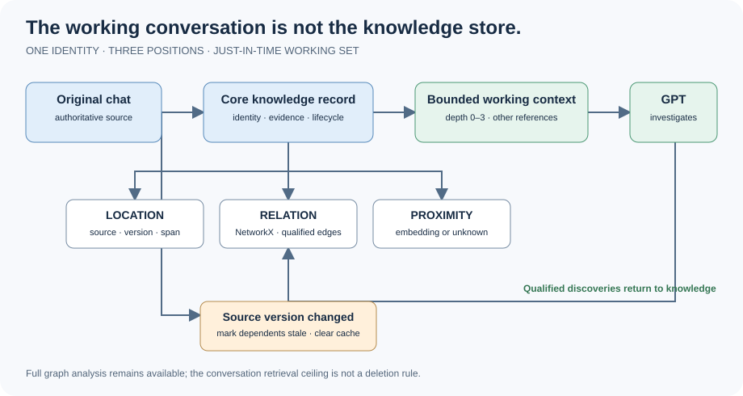

# Knowledge Positions SDF — specification and developer guide

**Experimental / pre-standard.** Language- and target-independent framework for source-backed knowledge navigation. The existing universal Rust scanner and target kits are implementations; the historical Python library is a reference, not a framework dependency.

**ONE KNOWLEDGE IDENTITY. THREE POSITIONS: LOCATION · RELATION · PROXIMITY.**

**Why this matters:** Existing direct, structural/AST, graph, lexical, vector and query methods can all operate on the *same source-backed knowledge identity* through its available recorded values. The value is **continuous, interchangeable investigation across methods**, not three separate indexes, mandatory steps or competing knowledge objects. A result located through one method can be traversed, filtered, ranked, verified or enriched through another without rebuilding it; each method still requires actual supporting values and an available adapter. This is the Knowledge Positions contribution to the broader, optional-method [Just-in-Time Knowledge effort](research/paper.md#12-the-larger-endeavor-jitk-knowledge-positions-and-practical-use). JITK itself does not require Knowledge Positions.

**Normative contract:** UKC/1 candidate. **Target:** any execution language. **Authority:** the linked normative UKC contract sections own their requirements. Research and experiments supply context and evidence; optional companion profiles apply only when selected.

## Start here

Use the [SDF developer guide and TOC](SDF/README.md) for the natural reading order, capture reference, SIPOC cookbook and conformance path. This page is the detailed UKC specification index, not a competing introductory guide.

## Existing examples and shortcuts

The original [Knowledge Positions README](README.md) explains the existing library and includes installation and capture instructions. The pages below put its existing examples, code and recorded results first.

1. **Get a result:** [GPS cold-context walkthrough](examples/gps/README.md) — the existing runnable Python example, with build, search, neighbors, and exact-source read commands.
2. **Compare with an expected result:** [Examples and recorded outputs](examples/README.md) — seven input examples, their source-backed records, and the recorded result JSON.
3. **See the available ingredients:** [Component and capability map](docs/component-and-capability-map.md) — existing code, actual entry points, and explicit gaps.
4. **Use a language or adapter:** [Python](languages/python/README.md), [Rust components](languages/rust/README.md), [TypeScript status](languages/typescript/README.md), or [OmniGraph adapters](adapters/README.md).
5. **Check the exact rules:** [Public operations](contracts/public-operations.md), [common record](contracts/common-record.md), and [conformance requirements](conformance/requirements.md).

## See what the finished example looks like

- [Seven source-to-record examples](examples/source-mappings.md): actual code, HTML, Markdown, CSV, and binary inputs beside the expected preserved fields and methods.
- [Recorded seven-source characterization](conformance/characterization.md): the existing result JSON and its explicit reproducibility limitation.
- [Original GPS evidence and replay](research/EXPERIMENT.md): the observed source-backed investigation and recorded artifacts.
- [Parser fidelity examples](readers/native-parser-fidelity.md): native parser observations and their field mapping.
- [Knowledge Positions diagram](diagrams/knowledge-loop.svg): original source, common record, and retrieval flow.

The historical examples and currently available Python package are not claims of a certified, full UKC/1 SDK. This landing page reorganizes the existing material rather than implementing new tools.

## SDK package and existing implementations

- [Component and capability map](docs/component-and-capability-map.md) — existing code, actual entry points, public-operation coverage, and verified gaps.
- [Python library entry point](languages/python/README.md) — current installable package and API.
- [Rust existing components](languages/rust/README.md) — native scanner/ingester source located in its current workspace.
- [TypeScript entry point](languages/typescript/README.md) — reserved language location; no existing binding claimed.
- [Adapter catalog](adapters/README.md) — reuse the existing OmniGraph adapter and native engine operations.

This index and the contract documents **do not themselves implement an executable UKC/1 SDK**. Existing components remain under their original ownership; certification requires the shared conformance contract. No new runtime, scanner, graph store or API service is introduced by this package map.

## Contract sections

- [0. FIRST LAW — the entire mechanism before any implementation detail](contracts/first-law.md)
- [1. Purpose, sources of authority and normative language](docs/authority-and-evidence.md)
- [2. The three positions and fourth-position extension](contracts/positions.md)
- [3. One logical record: the representation contract](contracts/common-record.md)
- [3.2.1 Parser fidelity is mandatory: raw input → native parser output → copied OKF values](readers/native-parser-fidelity.md)
- [3.2.2 Recovered native-to-common translation contract (mandatory; from working code and original research)](readers/native-to-common.md)
- [3.2.3 Recovered graph contract: ten algorithms, two additional operations, ten views](methods/graph-contract.md)
- [3.2.4 Existing location, evolution and recovery: selective behavior, not another ingestion phase](core/known-location-and-recovery.md)
- [3.3 Source → common OKF record → Location / Relation / Proximity: executable examples](examples/source-mappings.md)
- [3.4 Same stored values, different algorithms — implementation crosswalk](methods/algorithm-crosswalk.md)
- [3.5 Executed characterization — seven real inputs and one shared record per source](conformance/characterization.md)
- [3.6 On-touch enrichment and cold reconstruction — essential operational example](core/on-touch-recovery.md)
- [4. Identity, exact source positions and deterministic equality](core/identity.md)
- [5. Relationship rules and enrichment boundary](core/relations-and-enrichment.md)
- [6. Deterministic source acquisition and adapters](readers/source-adapters.md)
- [7. Proximity: useful even when imperfect; never blocking](methods/proximity.md)
- [8. Public SDK operations — required semantics, arbitrary language syntax](contracts/public-operations.md)
- [9. Retrieval and investigative loop](methods/retrieval.md)
- [10. Mandatory conformance suite: no claims without execution](conformance/requirements.md)
- [11. Lifecycles, updates, concurrency, storage and performance](core/lifecycle.md)
- [12. Implementer's SIPOC cookbook](docs/implementer-guide.md)
- [13. Future fourth position: Resonance](docs/resonance.md)

## Agent and Host Integration — optional, non-normative guidance

The following documents preserve guidance copied from the existing [Knowledge Positions OmniGraph skill](research/omnigraph/skills/knowledge-positions-omnigraph/SKILL.md). They are a separate, **non-normative agent/host integration profile**: deployment preferences and agent policies are not UKC/1 conformance obligations, and do not restrict language or engine independence. The original skill remains unchanged.

- [Skill overview and knowledge vocabulary](docs/agent-knowledge-overview.md)
- [Agent startup and official OmniGraph delegation](adapters/omnigraph/agent-startup.md)
- [SDK reference and graph-ingestion recommendation](docs/sdk-reference-usage.md)
- [Position, tree/AST, graph and vector capability selection](methods/agent-capabilities.md)
- [Knowledge access gates and agent coordination](methods/agent-knowledge-access.md)
- [JITK host contract](adapters/omnigraph/jitk-host-contract.md)
- [Local discovery priority](methods/local-discovery-priority.md)
- [Contribution and progressive disclosure](core/agent-contribution.md)

## Language locations

- [Rust](languages/rust/README.md)
- [TypeScript](languages/typescript/README.md)
- [Python](languages/python/README.md)

## Other component locations

- [Adapters](adapters/README.md)
- [Tools](tools/README.md)

Existing implementation, skills, tests, experiments, and research remain in their original locations.
